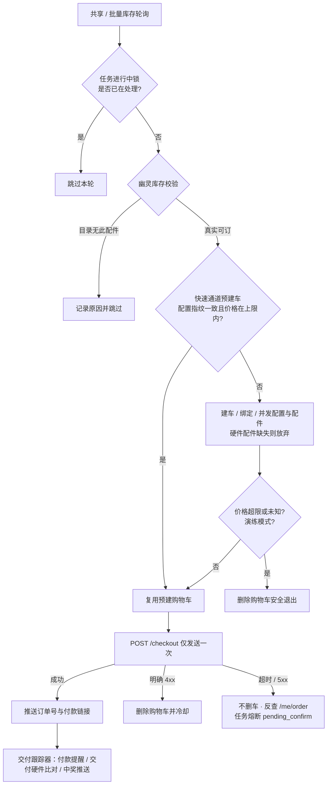

# 🎯 OVH Buyer (OVH Sniper) — OVH 独服 / Eco / VPS 自动抢购与监控面板

[](https://github.com/AtomBoyC/ovh-buyer/releases)
[](https://github.com/AtomBoyC/ovh-buyer/actions/workflows/ci.yml)
[](https://github.com/AtomBoyC/ovh-buyer/actions/workflows/docker-publish.yml)
[](https://hub.docker.com/r/atomboyc/ovh-buyer)
[](https://github.com/AtomBoyC/ovh-buyer/pkgs/container/ovh-buyer)
[](https://www.python.org/)
[](#-核心特性)
[](LICENSE)

为 **OVHcloud 黑五 / 闪购 / 日常补货** 打造的自动抢购与监控系统，覆盖 **Eco（Kimsufi / SoYouStart / Rise / KS-LE）**、**Baremetal（Advance / Game / Storage）** 与 **VPS**。

- **纯 Python 3.9+ 标准库**，零第三方依赖：本地 `python3 run.py` 直接跑，Docker 单容器镜像约 55MB。
- **安全第一**：演练模式、价格封顶、结账请求绝不重发、超时熔断防重单、同任务并发锁、硬件不降级。
- **好看好用**：v2.1 全新 Web 控制台（浅色 / 深色 / 跟随系统），零域名 Telegram Bot 一键抢购。

吸收了 `moonheart/OVH20251109`、`gokele/ovh`、`katorly/ovh-auto-buy`、`super888-png/stockhawk-ovh`、`PoorVPS/ovh-eco-telegram-order-bot` 等项目的经验。完整变更见 [CHANGELOG.md](CHANGELOG.md)。

| 深色主题 | 浅色主题 |
| :---: | :---: |
|  |  |

---

## 📌 目录

- [v2.1.0 更新了什么](#-v210-更新了什么)
- [核心特性](#-核心特性)
- [下单引擎流程](#-下单引擎流程)
- [一、本地运行](#-一本地运行macos--linux--windows)
- [二、Linux 服务器 Docker 部署](#-二linux-服务器-docker-部署)
- [三、申请 OVH API 凭据](#-三申请-ovh-api-凭据最小权限)
- [四、Web 控制台使用指南](#-四web-控制台使用指南)
- [五、Telegram Bot 与多渠道通知](#-五telegram-bot-与多渠道通知)
- [六、安全机制说明](#-六安全机制说明)
- [七、环境变量](#-七环境变量)
- [八、黑五实战清单](#-八黑五实战清单)
- [九、常见问题](#-九常见问题)
- [版本与分支](#-版本与分支)
- [项目结构](#-项目结构) · [运行测试](#-运行测试) · [免责声明](#️-免责声明与许可证)

---

## 🆕 v2.1.0 更新了什么

**界面全新设计**（参考 StockHawk 的简洁 SaaS 风格）：

- 浅色 / 深色 / 跟随系统 三种主题，侧边栏底部一键切换，刷新不闪屏
- SVG 线性图标替换 emoji，导航按「主功能 / 监控 / 配置」分组，任务数徽标
- 顶栏四个拨动开关（抢购引擎 / 快速通道 / 雷达 / VPS）+ 每页一句说明
- 统计条带、细边框表格、状态色标签、选项卡片式复选框（自动扣款等危险项勾选后变红）
- 弹窗标题与底部按钮固定，手机端侧边栏变为顶部横条，页面无横向滚动

**安全修复**（审查发现，强烈建议升级）：

| 问题 | 修复 |
| :--- | :--- |
| `POST /checkout` 遇到超时 / 5xx 会被自动重试 2~3 次，可能一次下出多单 | 结账等扣款请求**绝不重发**，只重试明确被拒的 429 / 时钟偏差 |
| 设了价格上限但取不到价格时，会跳过检查直接结账 | 价格未知一律取消下单（普通路径与快速通道） |
| 同一任务可能被主循环、手动执行、TG 一键抢购同时下单 | 任务级「进行中」锁；数据库读改写整体加锁 |
| 快速通道改了周期 / 优惠码 / 账号后仍复用旧购物车 | 完整配置指纹精确匹配；建车、复检、命中三次复核价格上限 |
| Telegram 抢购按钮可重复点，每次建一个无上限的实单任务 | 按钮一次性；必须有参考价，上限 = 参考价 +10%；群里只认授权用户 |
| 内存 / 硬盘配件挂载失败仍按基础配置结账 | 拒绝降级，放弃本次下单 |
| 任务绑定账号被删后会改用默认账号下单 | 不再串用账号 |
| `/api/export` 明文导出 Telegram Token 与 Webhook | 打码导出；改密码后旧会话全部失效；登录失败锁定；修复 XSS |

> [!NOTE]
> v2.1 不改数据库结构，v2.0 / v1.0 数据直接沿用。想回到旧版本，见 [版本与分支](#-版本与分支)。

---

## ✨ 核心特性

| 模块 | 说明 |
| :--- | :--- |
| **零依赖架构** | 纯 Python 3.9+ 标准库，无需 `pip install` / Node.js / Nginx；SQLite WAL 存储，旧版数据库启动时自动迁移。 |
| **⚡ 预建购物车快速通道** | 为开启快速通道的任务提前在最多 6 个机房建好、配好、验好价的购物车并自动续期；补货瞬间只需 **1 次 `POST /checkout`**。 |
| **🛡️ 结账防重单熔断** | 明确 4xx 拒绝立即删车；超时 / 断连 / 5xx 不重试不删车，反查 `/me/order`，任务熔断为 `pending_confirm` 并紧急告警。 |
| **👻 幽灵库存过滤** | 交叉校验库存 FQN 与官方目录（如 `27skle03-v1` 假库存），自动补齐必选配件（`bandwidth-*`），支持「仅抢默认标配」。 |
| **🎰 交付跟踪 & 硬件中奖** | 自动追踪 `未付款 → 核查中 → 交付中 → 已交付`，交付后比对实机硬件，内存 / 硬盘 / CPU 升级推送「恭喜中奖」。 |
| **💱 人民币估价** | ECB 汇率（离线兜底），目录、订单、短链预览、推送都附 `≈ ¥xxx`。 |
| **📣 Telegram Bot** | 零域名 Long Polling；HTML 补货卡片 + API 抢购按钮 + OVH Express 直达按钮，售罄自动划删除线；`/order` 短链下单、`/servers` 查独服。 |
| **🔗 `@ovheco` 短链下单** | 本地解码 `/o/<region>/<token>`，建车报实时含税价，二次确认生成未付款订单（防双击）。 |
| **📡 黑五雷达 & VPS 监控** | 新品上线雷达（`new_sku`）+ 配置指纹狙击（`config_match`，如 `>=32g` + `nvme`）；VPS 多机房补货监控；**支持 HTTP / HTTPS / SOCKS5 监控专用代理池自动轮询与故障切换**。 |
| **🔑 多账号 & 最小权限** | EU / CA / US 多账号，凭据可静态加密；内置最小权限 Token 申请链接；测试连通时检查默认支付方式。 |
| **🎨 Web 控制台** | 浅色 / 深色主题，密码 / API-Key 门禁，SSE 实时日志，适配手机；另有无头模式与 CLI 工具。 |

---

## 🧭 下单引擎流程



---

## 🚀 一、本地运行（macOS / Linux / Windows）

只需 **Python 3.9+**，无需安装任何依赖：

```bash
git clone https://github.com/AtomBoyC/ovh-buyer.git
cd ovh-buyer

# macOS / Linux
chmod +x scripts/start-local.sh
./scripts/start-local.sh

# Windows / 通用
python3 run.py
```

打开 **http://127.0.0.1:8888**。

> [!TIP]
> 不配置任何 OVH 密钥也能用「目录与查货」和「秒查实时库存」——它们走 OVH 公开接口。

### 命令行工具

```bash
python3 run.py check 27skle01-v1 --endpoint ovh-eu                    # 查某型号各机房库存
python3 run.py catalog --endpoint ovh-eu --subsidiary IE --search skle # 搜索 Eco 目录（按价格排序）
python3 run.py vps vps-2025-model1 --endpoint ovh-eu --subsidiary IE   # 查 VPS 库存
python3 run.py --headless                                              # 仅后台引擎 + Telegram Bot
```

---

## 🐳 二、Linux 服务器 Docker 部署

推送 `main` 或发布 Release 时，GitHub Actions 自动构建 **`linux/amd64` + `linux/arm64`** 双架构镜像并推送到两个仓库，任选其一：

| 仓库 | 最新版 | 固定版本 | 主页 |
| :--- | :--- | :--- | :--- |
| **GHCR** | `ghcr.io/atomboyc/ovh-buyer:latest` | `ghcr.io/atomboyc/ovh-buyer:2.1.0` | [GitHub Packages](https://github.com/AtomBoyC/ovh-buyer/pkgs/container/ovh-buyer) |
| **Docker Hub** | `atomboyc/ovh-buyer:latest` | `atomboyc/ovh-buyer:2.1.0` | [Docker Hub](https://hub.docker.com/r/atomboyc/ovh-buyer) |

> 旧版镜像仍然保留：`:2.0.0` / `:1.0.0`。

### 方式 A：一条 `docker run`

```bash
mkdir -p ~/ovh-buyer/data && cd ~/ovh-buyer
docker run -d \
  --name ovh-sniper \
  --restart unless-stopped \
  -p 8888:8888 \
  -e TZ=Asia/Shanghai \
  -e PANEL_PASSWORD="请改成你的强密码" \
  -v $(pwd)/data:/app/data \
  atomboyc/ovh-buyer:latest
```

### 方式 B：只下载 `docker-compose.yml`（推荐）

```bash
mkdir -p ~/ovh-buyer && cd ~/ovh-buyer
curl -fsSLO https://raw.githubusercontent.com/AtomBoyC/ovh-buyer/main/docker-compose.yml
curl -fsSLO https://raw.githubusercontent.com/AtomBoyC/ovh-buyer/main/.env.example
cp .env.example .env
nano .env        # 必改 PANEL_PASSWORD；想用 Docker Hub 就取消注释 OVH_IMAGE
docker compose pull && docker compose up -d
docker compose logs -f
```

访问 **http://<服务器IP>:8888**。

### 方式 C：克隆仓库用脚本部署

```bash
git clone https://github.com/AtomBoyC/ovh-buyer.git && cd ovh-buyer
chmod +x scripts/deploy-docker.sh
./scripts/deploy-docker.sh                                        # 拉取预构建镜像（自动生成随机密码）
OVH_IMAGE=atomboyc/ovh-buyer:latest ./scripts/deploy-docker.sh    # 从 Docker Hub 拉取
./scripts/deploy-docker.sh --build                                # 本地源码构建
```

### 方式 D：无头模式（极简 VPS）

1. 复制 `config.example.json` 到 `./data/config.json`，填好账号、任务、雷达规则
2. `.env` 设置 `HEADLESS=true`、`TELEGRAM_BOT_TOKEN`、`TELEGRAM_CHAT_ID`
3. `docker compose up -d`，全程用 Telegram 控制

### 升级与维护

```bash
docker compose pull && docker compose up -d   # 升级到最新版，./data 数据保留
docker compose logs -f ovh-sniper             # 实时日志
docker compose down                           # 停止并移除
```

固定在某个版本：`.env` 里写 `OVH_IMAGE=ghcr.io/atomboyc/ovh-buyer:2.1.0`。

### 公网部署建议

> [!WARNING]
> 不设置 `PANEL_PASSWORD` 时面板**完全开放**，任何人都能下单、改密码。部署到公网服务器务必设置强密码。

推荐把端口改成 `127.0.0.1:8888:8888`，前置 **Cloudflare Tunnel (`cloudflared`)** 或 **Caddy / Nginx** 提供 HTTPS（反代传 `X-Forwarded-Proto: https` 或 `CF-Visitor` 时会话 Cookie 自动加 `Secure`，且自动从 `CF-Connecting-IP` / `X-Forwarded-For` 识别真实访客 IP）：

#### 方案 1：Cloudflare Tunnel 零公网端口穿透（推荐）

1. 将 `docker-compose.yml` 中的 `ports` 改为仅监听本机回环：`"127.0.0.1:8888:8888"`。
2. 在宿主机启动 `cloudflared`（**关键：若用 Docker 运行 `cloudflared`，务必加 `--network host`（否则容器内 `127.0.0.1` 指向 `cloudflared` 自己会报 `502`），并建议加 `--protocol http2` 避免部分 VPS 出站 UDP 7844 不通报 `Error 1033`**）：

```bash
docker run -d \
  --name cloudflared \
  --restart unless-stopped \
  --network host \
  cloudflare/cloudflared:latest \
  tunnel --no-autoupdate --protocol http2 run --token <你的Tunnel_Token>
```

3. 在 Cloudflare Zero Trust → **Networks → Tunnels → Published applications** 添加域名并指向 `http://127.0.0.1:8888`（若不加 `--network host`，则将两个容器放进同一 Docker 网络并填 `http://ovh-sniper:8888`，或填宿主机网桥 IP `http://172.17.0.1:8888`）。

#### 方案 2：Nginx / Caddy 反向代理

```nginx
location / {
    proxy_pass http://127.0.0.1:8888;
    proxy_set_header Host $host;
    proxy_set_header X-Real-IP $remote_addr;
    proxy_set_header X-Forwarded-Proto $scheme;
    proxy_http_version 1.1;
    proxy_buffering off;   # SSE 实时日志需要
}
```

> Fork 后想推送到自己的 Docker Hub：在仓库 `Settings → Secrets → Actions` 添加 `DOCKERHUB_USERNAME` 与 `DOCKERHUB_TOKEN`。

---

## 🔑 三、申请 OVH API 凭据（最小权限）

在控制台 **「OVH 账号」** 页点击对应区域按钮，会打开已预填以下权限的申请页（**不会申请删机 / 重装 / 重启等危险权限**）：

- `GET /me`、`GET /me/*` —— 账户信息、余额、订单状态、默认支付方式
- `GET/POST/PUT/DELETE /order/*` —— 建车、配置、查价、结账、删除临时购物车
- `GET /dedicated/server`、`GET /dedicated/server/*` —— 只读查看已交付独服（中奖比对、`/servers`）

| 区域 | Endpoint | 常见子公司 | 手动申请入口 |
| :--- | :--- | :--- | :--- |
| 欧洲 | `ovh-eu` | `IE`、`FR`、`DE`、`GB`、`ES`、`NL`、`PL` | https://eu.api.ovh.com/createToken/ |
| 加拿大 / 亚太 | `ovh-ca` | `CA`、`SG`、`AU`、`ASIA`、`IN` | https://ca.api.ovh.com/createToken/ |
| 美国 | `ovh-us` | `US` | https://api.us.ovhcloud.com/createToken/ |

有效期建议 `30 days` 或 `Unlimited`。添加账号后点 **「测试连通」**，会显示 `nichandle`、余额和默认支付方式（如 `💳 PAYPAL`；未绑定会提示 `⚠️ 无默认支付`）。

---

## 🖥️ 四、Web 控制台使用指南

| 页面 | 用途 |
| :--- | :--- |
| **总览** | 运行中任务、成功订单、轮询/命中次数、账号数；秒查任意型号库存；活跃任务与最近订单 |
| **目录与查货** | 拉取 OVH 官方目录（含人民币估价）；「查库存」弹窗显示各机房状态、⚠️ 幽灵库存标记和 OVH 官网直达按钮；点绿色机房可直接建任务 |
| **抢购任务** | 任务列表：快速通道预建车就绪情况（如 `GRA(55m)`）、`⚠️ 待核对(防重单)` 状态、演练 / 编辑 / 暂停 |
| **订单与交付** | `@ovheco` 短链下单；订单历史含 OVH 官方状态、交付主机、🎰 中奖标记；「查交付」「我的独服」「同步官方订单」 |
| **黑五雷达** | 新品上线 / 配置指纹规则，命中后可自动建任务 |
| **VPS 监控** | 各机房 VPS 套餐补货状态，可选自动下单 |
| **OVH 账号** | 多账号管理、最小权限 Token 申请、连通性与支付方式检查 |
| **通知与设置** | 推送渠道、限流与代理、功能开关、推送事件、面板密码、配置导出（敏感项打码） |
| **运行日志** | SSE 实时日志，可按级别 / 模块过滤 |

新建任务时的关键选项：

| 选项 | 说明 |
| :--- | :--- |
| 演练模式 | 实际建车、配置、查含税价，但不结账。**新任务建议先演练** |
| 快速通道 | 提前建好购物车，有货一次请求结账；需要明确勾选机房 |
| 自动扣款 | 用默认支付方式 / 余额直接付款（勾选后卡片变红提醒） |
| 允许非默认配置 | 取消则只抢默认内存 / 硬盘配置 |
| 价格上限 | 超过上限或**取不到价格**都会取消下单；可选按含税价判断 |
| 仅抢现货 | 忽略 24H / 72H / 240H 等排队交付的机房 |

---

## 🤖 五、Telegram Bot 与多渠道通知

在 **「通知与设置」** 填入 `Bot Token` 与 `Chat ID`（多个用英文逗号分隔），勾选「启用 Bot 交互指令与一键下单按钮」即可，**无需域名、Webhook 或证书**。

| 命令 / 交互 | 说明 |
| :--- | :--- |
| `/status` | 引擎、快速通道、交付跟踪、雷达、VPS 状态与统计 |
| `/tasks` | 任务列表（`⚡` 快速通道、`⚠️` 待核对） |
| `/check <planCode> [endpoint]` | 实时库存，标记幽灵库存 |
| `/order <短链>` | 解析 `@ovheco` 短链，报价后点确认生成未付款订单 |
| `/servers` | 账号名下已交付独服 |
| `/orders` | 近期订单与付款链接 |
| `/id` | 查看当前会话的 `Chat ID`、话题 `Topic ID` 与个人 `User ID` |
| `/pause` / `/resume` | 暂停 / 恢复抢购引擎 |
| `🛒 GRA API抢购` 按钮 | 一次性按钮；需有参考价，自动建「上限 = 参考价 +10%」的实单任务（比例可用 `quick_buy_price_margin` 设置调整） |
| `🌐 官网直达` 按钮 | 打开 OVH Express 结账页 |

### 推送到指定 Topic（话题）的三种写法（v2.1.2+）

> [!NOTE]
> Telegram 官方本身不支持在**单向广播频道（Channel）**里创建多个子话题；所谓「分频道 / 多 Topic」需要使用 **开启了话题（Topics）功能的超级群组（Supergroup）**（或给频道绑定一个开启话题的讨论群组），并将机器人拉入群组赋予发消息权限。

1. **直接粘贴话题链接（最省事）**：在 Telegram 右键目标话题点击 **「复制话题链接 (Copy Topic Link)」**（如 `https://t.me/c/2134567890/45` 或 `https://t.me/mygroup/45`），原样粘贴进面板 `Chat ID` 即可自动识别群组与 Topic ID。
2. **`Chat ID/Topic ID` 简写（支持同时推多个不同群/不同话题）**：在 `Chat ID` 中直接填 `-1002134567890/45`（兼容 `/`、`:`、`#` 分隔，多个目标用英文逗号分隔）。
3. **独立输入框**：`Chat ID` 填 `-1002134567890`，旁边的 **「默认话题 Topic ID」** 填 `45`（也可在群话题里发 `/id` 查看当前话题 ID）。

> [!IMPORTANT]
> **群组按钮授权**：在群组或话题中点击抢购按钮 / 发送指令时，操作人的个人 User ID 需要在 **「群组授权用户 ID」**（`TELEGRAM_ADMIN_IDS`，仅授权不重复收私聊推送）或 `Chat ID` 列表中；未授权用户点击按钮时会弹窗提示其个人 ID 方便添加。私聊不受影响。

还支持同时推送到 **Bark**、**Server酱**、**钉钉（含加签）**、**飞书**、**Discord** 和 **自定义 JSON Webhook**。

---

## 🛡️ 六、安全机制说明

| 机制 | 行为 |
| :--- | :--- |
| 演练模式 | 走完整建车、配置、查价流程，最后删车，不结账 |
| 价格封顶 | 普通路径、快速通道建车、复检、命中时都检查；**价格未知 = 不下单** |
| 结账不重发 | `POST /checkout` 只发一次；连接池断线、5xx、超时都不会重发 |
| 防重单熔断 | 结果不确定时不删车、反查 `/me/order`，任务进入 `pending_confirm`，需要你核对后手动恢复 |
| 并发锁 | 同一任务同一时间只会有一个线程在检测 / 下单；VPS 轮询串行执行 |
| 购买配额 | `max_orders` 原子计数，达到即完成 |
| 硬件不降级 | 内存 / 硬盘配件缺失或挂载失败时放弃下单 |
| 账号隔离 | 任务绑定账号不存在时不下单，不会改用默认账号 |
| 面板安全 | PBKDF2 密码哈希、HMAC 签名 HttpOnly Cookie、改密码后旧会话失效、8 次失败锁定 5 分钟、导出打码 |

---

## ⚙️ 七、环境变量

完整示例见 [.env.example](.env.example)：

| 变量 | 默认值 | 说明 |
| :--- | :--- | :--- |
| `OVH_IMAGE` | `ghcr.io/atomboyc/ovh-buyer:latest` | Compose 使用的镜像，可改为 `atomboyc/ovh-buyer:latest` 或 `:2.1.0` |
| `PORT` / `HOST` | `8888` / `0.0.0.0` | 监听端口与地址 |
| `TZ` | `Asia/Shanghai` | 时区 |
| `PANEL_PASSWORD` | 空 | 面板密码（也可用 `X-API-Key` 请求头调用 API）。**公网务必设置** |
| `DATA_ENCRYPTION_KEY` | 空 | 可选，OVH 凭据静态加密密钥 |
| `OVH_DATA_DIR` | `./data` | 数据库与缓存目录 |
| `PUID` / `PGID` | `1000` / `1000` | Docker 容器运行与修正 `/app/data` 归属的目标 UID / GID |
| `HEADLESS` | `false` | `true` 时只运行后台引擎与 Telegram Bot |
| `OVH_MONITOR_PROXIES` | 空 | 监控专用代理 / 代理池（支持多条轮询，`http://`、`https://`、`socks5://` 及 `ip:port:user:pass`） |
| `OVH_HTTP_PROXY` / `HTTPS_PROXY` | 空 | 兜底全局代理，如 `http://127.0.0.1:7890` |
| `TELEGRAM_BOT_TOKEN` / `TELEGRAM_CHAT_ID` | 空 | Telegram 机器人与推送目标（支持 `-100xxx/话题ID` 或 `https://t.me/c/xxx/话题ID`） |
| `TELEGRAM_TOPIC_ID` / `TELEGRAM_ADMIN_IDS` | 空 | 可选，默认群组话题 `message_thread_id` 与群内按钮授权个人 ID 列表 |
| `OVH_ENDPOINT` / `OVH_SUBSIDIARY` / `OVH_APP_KEY` / `OVH_APP_SECRET` / `OVH_CONSUMER_KEY` | 空 | 可选，首次启动自动导入的默认账号 |

---

## ⚡ 八、黑五实战清单

1. **先演练**：新任务勾选「演练模式」，点「演练」确认签名、建车、配件、含税价都正常，再切实单。
2. **热门款开快速通道**：为 KS-LE / KS-LE-B 等勾选 1~3 个核心机房并开启快速通道，列表显示 `⚡ 预建就绪: GRA(55m)` 即已热备。
3. **一定设价格上限**：防止高配加价或安装费；取不到价格时也会自动放弃。
4. **处理 `⚠️ 待核对(防重单)`**：先到 OVH 后台或点「同步官方订单」确认是否已下单，确认没下单再点「核对后恢复」，不要新建重复任务。
5. **准备好支付**：自动扣款推荐 PayPal（免 3DS）或提前充值余额；测试连通应显示默认支付方式。
6. **控制轮询频率**：全局 QPS 3~5、单任务 3~5 秒；监控 ≥3 个型号会自动合并为一次批量请求。
7. **提前开雷达**：建 `new_sku` 规则（如 `26skle|27skle|bf`）并打开顶栏「雷达」，首次扫描记录基线。

---

## ❓ 九、常见问题

**Q：设置了价格上限，但任务一直「下单失败：无法获取购物车实时价格」？**
OVH 查价接口临时不可用。v2.1 起为安全起见不会盲下，接口恢复后会自动继续。

**Q：群里点 TG 按钮没反应？**
把你自己的 Telegram 用户 ID 加到 `Chat ID` 列表（见[第五节](#-五telegram-bot-与多渠道通知)）。

**Q：TG 提示「未获取到参考价，已拒绝一键抢购」？**
该补货通知没带目录价格。到面板手动建一个带价格上限的任务即可。

**Q：改了面板密码后被退出登录？**
这是预期行为：改密码会让所有旧会话失效，在当前页面改密码的浏览器会自动拿到新会话。

**Q：怎么切换浅色 / 深色？**
侧边栏左下角三个图标：跟随系统 / 浅色 / 深色，选择会保存在浏览器里。

**Q：升级会丢数据吗？**
不会。数据都在 `./data`，启动时自动迁移结构。

**Q：旧版镜像启动报 `sqlite3.OperationalError: unable to open database file`？**
这是 v2.1.0 镜像在宿主机 `./data` 为 `root:root (755)` 时的挂载权限问题，已在 **v2.1.1+** 修复。直接执行 `docker compose pull && docker compose up -d` 升级最新镜像即可（若暂不拉取新镜像，在宿主机执行 `chmod 777 ./data` 或 `chown -R 100:101 ./data` 也可立即恢复）。

**Q：裸连 `IP:8888` 正常，但用 Cloudflare Tunnel (`cloudflared`) 反代打不开？**
按浏览器报错代码对应排查：
- **报 `Error 1033 (Cloudflare Tunnel error)`**：说明 Cloudflare 边缘节点连不上你的 `cloudflared` 客户端（与 8888 端口无关）。① 检查 Zero Trust → Tunnels 状态是否为绿色 `HEALTHY`；② 很多 VPS 出站 UDP 7844 (QUIC) 被限流/丢包，给 `cloudflared` 启动参数加上 `--protocol http2` 强制走 TCP 即可秒通；③ 若隧道已是 `HEALTHY` 仍报 `1033`，去域名 **DNS → 记录** 检查该子域名的 `CNAME`（`<UUID>.cfargotunnel.com`）是否残留了以前删掉的旧隧道 UUID，改成当前隧道的 UUID 即可。
- **报 `502 Bad Gateway`**：通常是因为 `cloudflared` 也跑在 Docker 容器里（默认桥接网络），此时填 `http://127.0.0.1:8888` 访问的是 `cloudflared` 容器自己。给 `cloudflared` 容器加 `--network host`，或把 CF 后台地址改成宿主机 Docker 网桥 IP（如 `http://172.17.0.1:8888`）或同网络容器名 `http://ovh-sniper:8888`。
- **报 `403 Forbidden (Sorry, you have been blocked)`**：域名开启了高强度 WAF / Bot Fight Mode 拦截了面板 API 请求。在 Cloudflare **安全性 → WAF → 自定义规则** 为该子域名添加一条 **跳过 (Skip)** 规则（推荐改用 Cloudflare Zero Trust **Access** 邮箱验证码保护后台）。

---

## 🌿 版本与分支

| 分支 / 标签 | 内容 |
| :--- | :--- |
| `main` | 最新版 **v2.1.x**（新界面 + 安全 + Docker/反代/Topic/监控代理池），镜像 `:latest` / `:2.1.3` |
| [`legacy-v2.0`](https://github.com/AtomBoyC/ovh-buyer/tree/legacy-v2.0) | v2.0.0 旧界面版本，仅存档、不再更新；镜像 `:2.0.0` |
| 标签 `v1.0.0` / `v2.0.0` / `v2.1.0` / `v2.1.1` / `v2.1.2` / `v2.1.3` | 对应各 [Release](https://github.com/AtomBoyC/ovh-buyer/releases) |

想继续用旧界面：

```bash
git clone -b legacy-v2.0 https://github.com/AtomBoyC/ovh-buyer.git
# 或 Docker：OVH_IMAGE=ghcr.io/atomboyc/ovh-buyer:2.0.0
```

> [!CAUTION]
> `legacy-v2.0` 不包含 v2.1 的安全修复（结账重发、价格未知仍下单等），用于真实抢购请务必使用 `main`。

---

## 📂 项目结构

```text
ovh-buyer/
├── run.py                      # 统一入口（Web 控制台 / Headless / CLI）
├── Dockerfile                  # Alpine 单容器镜像 (~55MB)
├── docker-compose.yml          # Compose 编排（默认拉取预构建镜像）
├── docker-compose.build.yml    # 本地源码构建覆盖配置
├── CHANGELOG.md                # 版本更新日志
├── .env.example                # 环境变量模板
├── config.example.json         # 声明式配置导入模板
├── docs/screenshots/           # README 截图
├── scripts/
│   ├── start-local.sh          # 本地一键启动
│   └── deploy-docker.sh        # 服务器 Docker 一键部署
├── ovh_buyer/
│   ├── config.py               # 区域 / 机房元数据、最小权限 Token、Express 链接、短链解码
│   ├── database.py             # 线程安全 SQLite、自动迁移、静态加密、导出打码
│   ├── ovh_client.py           # OVH API 客户端（签名 / 校时 / 连接池 / 限流 / 扣款请求不重发）
│   ├── catalog.py              # 目录解析、幽灵库存过滤、必选配件、公共周期
│   ├── specs.py                # 汇率转换、官方与实机硬件比对
│   ├── order_engine.py         # 建车 / 结账、价格封顶、快速通道 CartSlotPool、防重单熔断
│   ├── tracker.py              # 订单付款 / 交付跟踪与中奖推送
│   ├── sniper.py               # 轮询调度、任务并发锁、快速通道维护、雷达、VPS 监控
│   ├── notifier.py             # 多渠道通知 + Telegram Bot
│   ├── auth.py                 # 密码哈希、签名会话、会话轮换
│   ├── web_server.py           # REST API + SSE 日志 + 静态资源 + 登录限流
│   └── web/                    # 前端（HTML / CSS / JS，零 CDN，浅色 / 深色主题）
├── tests/test_core.py          # 单元测试 + 本地 Mock OVH API 端到端测试
└── .github/workflows/
    ├── ci.yml                  # 自动测试与 Docker 构建验证
    └── docker-publish.yml      # 双架构镜像发布到 GHCR 与 Docker Hub
```

---

## 🧪 运行测试

```bash
python3 -m unittest discover -s tests -v
```

---

## ⚠️ 免责声明与许可证

- 本项目为非 OVHcloud 官方项目，仅供学习交流与个人合法自动化管理 OVHcloud 账户使用。请遵守 OVHcloud 服务条款与 API 速率规范。
- 自动下单与自动扣款涉及真实资金，请先用 **演练模式** 与 **价格上限** 充分验证。
- 基于 [MIT License](LICENSE) 开源。
