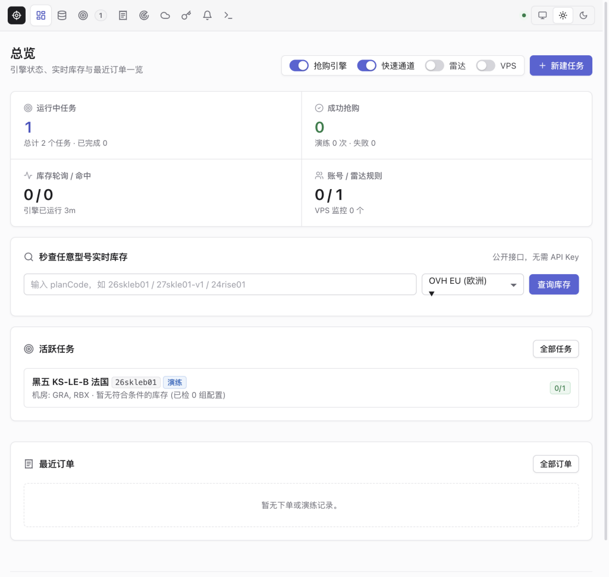
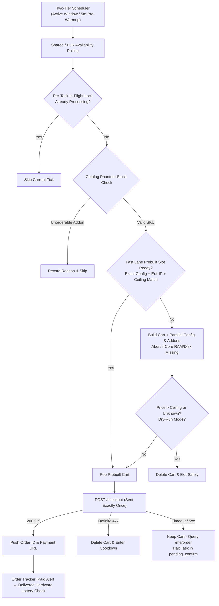

# 🎯 OVH Buyer (OVH Sniper) — Zero-Dependency OVHcloud Dedicated / Eco / VPS Auto-Buyer & Stock Monitor

> 🌐 **Language**: **English** | **[简体中文 (Simplified Chinese)](README.zh-CN.md)**

[](https://github.com/AtomBoyC/ovh-buyer/releases)
[](https://github.com/AtomBoyC/ovh-buyer/actions/workflows/ci.yml)
[](https://github.com/AtomBoyC/ovh-buyer/actions/workflows/docker-publish.yml)
[](https://hub.docker.com/r/atomboyc/ovh-buyer)
[](https://github.com/AtomBoyC/ovh-buyer/pkgs/container/ovh-buyer)
[](https://www.python.org/)
[](#-core-features)
[](LICENSE)

An automated server sniper, restock radar, and delivery tracker built for **OVHcloud Black Friday, Flash Sales, and daily restocks** across **Eco (`Kimsufi` / `SoYouStart` / `Rise` / `KS-LE`)**, **Baremetal (`Advance` / `Game` / `Storage`)**, and **VPS** product lines.

- **100% Python 3.9+ Standard Library (Zero Third-Party Dependencies)**: run `python3 run.py` directly on macOS / Linux / Windows with no `pip install` or Node.js toolchain, or deploy as a ~55MB multi-arch Alpine Docker container.
- **Real-Money Safety First**: Dry-Run mode, strict price ceiling guard (aborts if price is unknown), single-attempt `POST /checkout` (never resends ambiguous timeouts/5xx), `pending_confirm` anti-double-order fuse, per-task concurrency locks, and hardware non-downgrade protection.
- **Two-Tier Scheduling & Two-Tier Proxy Pool**: schedule daily/overnight active windows or flash-sale countdowns with **5-minute Fast Lane cart pre-warmup**, backed by staggered 1-by-1 silent proxy latency probing (`HTTP` / `HTTPS` nested TLS / `SOCKS5`).

See [CHANGELOG.md](CHANGELOG.md) for the complete release history.

| Dark Theme | Light Theme |
| :---: | :---: |
|  |  |

---

## 📌 Table of Contents

- [What's New in v2.2.0](#-whats-new-in-v220)
- [Core Features](#-core-features)
- [Checkout & Safety Architecture](#-checkout--safety-architecture)
- [1. Local Quick Start (macOS / Linux / Windows)](#-1-local-quick-start-macos--linux--windows)
- [2. Docker Deployment on Linux Servers](#-2-docker-deployment-on-linux-servers)
- [3. Least-Privilege OVH API Credentials](#-3-least-privilege-ovh-api-credentials)
- [4. Web Console Guide](#-4-web-console-guide)
- [5. Two-Tier Scheduled Sniping & Monitoring](#-5-two-tier-scheduled-sniping--monitoring)
- [6. Two-Tier Monitoring Proxy Pool](#-6-two-tier-monitoring-proxy-pool)
- [7. Telegram Bot & Multi-Channel Notifications](#-7-telegram-bot--multi-channel-notifications)
- [8. Real-Money Safety Guarantees](#-8-real-money-safety-guarantees)
- [9. Environment Variables](#-9-environment-variables)
- [10. FAQ & Cloudflare Tunnel Troubleshooting](#-10-faq--cloudflare-tunnel-troubleshooting)
- [Branches & Releases](#-branches--releases) · [Project Structure](#-project-structure) · [Running Tests](#-running-tests)

---

## 🆕 What's New in v2.2.0

- **⏰ Two-Tier Scheduled Sniping & Monitoring (`ovh_buyer/scheduler.py`)**:
  - **Item-Level Schedules** built directly into Sniper Tasks, Black Friday Radar rules, and VPS Watches: supports `Daily Active Windows` (including multi-range and overnight spans like `22:00-02:00` + weekday filters) and `Date/Time Ranges` (flash-sale start/end countdowns with automatic pause on completion).
  - **⚡ Fast Lane Pre-Warmup**: scheduled Fast Lane tasks automatically prebuild and price-verify shopping carts **5 minutes before** the window opens so 1-call `POST /checkout` is ready at second zero, while keeping zero carts and zero API polls outside active hours.
  - **Global Schedule Center (`Schedules` tab & Telegram `/schedule`)**: edge-triggered window guards, daily triggers, and one-shot rules across configurable timezones (`Asia/Shanghai`, `Europe/Paris`, `America/New_York`, `UTC`, etc.) that toggle engines/tasks and dynamically scale peak vs. off-peak QPS without overriding manual mid-window switches.
- **🌐 Universal Proxy Transport & Two-Tier Auto Proxy Pool Hardening**:
  - Genuine nested **TLS-in-TLS (`https://` proxy -> `https://` API)** via stdlib `ssl.MemoryBIO`, deterministic socket cleanup, and `403 / 407 / 429` tunnel status propagation for instant dead-proxy quarantine.
  - Full `http://`, `https://`, `socks5://`, `socks5h://`, and `[scheme://]host:port:user:pass` shorthand support across **OVH API, Telegram Bot, all Webhooks, FX rate fetching, and CLI tools**.
- **🔐 Expanded At-Rest Encryption & Masked UI Round-Tripping**:
  - `DATA_ENCRYPTION_KEY` now encrypts proxy credentials and notification tokens/webhooks at rest in SQLite; REST APIs mask proxy passwords (`:****@`) while seamlessly preserving unchanged passwords when editing or speed-testing in the Web Console.
  - Fast Lane `CartSlotPool` fingerprints now bind the effective exit `proxy_url` so cart creation and checkout always share the same IP.
- **⚡ Sub-Second Flash-Sale Polling**: supports `poll_interval >= 0` (`0.05s` loop cadence) with intelligent SQLite write throttling when stock state is unchanged.

---

## ✨ Core Features

| Module | Highlights |
| :--- | :--- |
| **Zero-Dependency Runtime** | Pure Python 3.9+ stdlib (`sqlite3` WAL, `http.client`, `ssl`, `zoneinfo`) + vanilla HTML/CSS/JS; zero CDN requests; automatic schema migrations across v1.0 → v2.2. |
| **⚡ Prebuilt Cart Fast Lane** | Prebuilds, configures, attaches addons, and verifies live prices across up to 6 target datacenters ahead of time; stock hit triggers **1 single `POST /checkout`**. |
| **⏰ Two-Tier Scheduler** | Per-task/radar/VPS active windows & flash-sale countdowns (with Fast Lane pre-warmup) + global edge-triggered schedule rules & peak/idle QPS switching. |
| **🌐 Two-Tier Auto Proxy Pool** | Master Pool → Top-N lowest-latency Active Pool via staggered 1-by-1 silent background probing (`1.5s–4.0s` random jitter), instant failover hot-swap, and optional strict no-local-IP-leak guard. |
| **🛡️ Anti-Double-Order Fuse** | Definite 4xx rejections immediately clean up the cart; ambiguous timeouts / 5xx **never retry and never delete the cart**, cross-checking `/me/order` and halting the task in `pending_confirm`. |
| **👻 Phantom Stock Guard** | Cross-validates availability FQNs against live OVH catalogs (filtering unorderable phantom SKUs such as `27skle03-v1`), auto-resolves mandatory `bandwidth-*` addons, and supports `Base Config Only`. |
| **🎰 Delivery & Hardware Lottery** | Tracks `notPaid → paid → delivered`, links the provisioned `serviceName`, compares actual CPU / RAM / NVMe specs against catalog baselines, and alerts on free hardware upgrades ("OVH Lottery"). |
| **📣 Zero-Domain Telegram Bot** | Built-in Long Polling (no domain/SSL/webhook needed), HTML restock cards with 1-click API buy + OVH Express direct checkout links, automatic sold-out `<s>strikethrough</s>`, Forum Topic routing, and `/order` `@ovheco` short-link checkout. |

---

## 🧭 Checkout & Safety Architecture



---

## 🚀 1. Local Quick Start (macOS / Linux / Windows)

Requires **Python 3.9+** only — no external packages needed:

```bash
git clone https://github.com/AtomBoyC/ovh-buyer.git
cd ovh-buyer

# macOS / Linux
chmod +x scripts/start-local.sh
./scripts/start-local.sh

# Windows / Cross-platform
python3 run.py
```

Open **http://127.0.0.1:8888** in your browser.

> [!TIP]
> You can use **Catalog & Stock Lookup** and **Quick Live Availability Check** immediately without configuring any OVH API keys — both query public OVH endpoints.

### CLI Subcommands

```bash
python3 run.py check 27skle01-v1 --endpoint ovh-eu                    # Live datacenter stock for a planCode
python3 run.py catalog --endpoint ovh-eu --subsidiary IE --search skle # Search public Eco catalog
python3 run.py vps vps-2025-model1 --endpoint ovh-eu --subsidiary IE   # Check VPS datacenter availability
python3 run.py serve --headless                                        # Run background daemon + Telegram Bot only
```

---

## 🐳 2. Docker Deployment on Linux Servers

Prebuilt multi-arch images (`linux/amd64` & `linux/arm64`, ~55MB) are published automatically to both **GitHub Container Registry (GHCR)** and **Docker Hub**:

- GHCR: `ghcr.io/atomboyc/ovh-buyer:latest` / `ghcr.io/atomboyc/ovh-buyer:2.2.0`
- Docker Hub: `atomboyc/ovh-buyer:latest` / `atomboyc/ovh-buyer:2.2.0`

### Option A: One-Command Deploy Script

```bash
git clone https://github.com/AtomBoyC/ovh-buyer.git
cd ovh-buyer
chmod +x scripts/deploy-docker.sh
./scripts/deploy-docker.sh
```

On first run, `deploy-docker.sh` generates `.env` with a random 16-character `PANEL_PASSWORD`, prepares `./data`, pulls the prebuilt image, and prints the login credentials.

### Option B: Standalone `docker-compose.yml` (No `git clone` Needed)

```bash
mkdir ovh-buyer && cd ovh-buyer
curl -fsSLO https://raw.githubusercontent.com/AtomBoyC/ovh-buyer/main/docker-compose.yml
curl -fsSLO https://raw.githubusercontent.com/AtomBoyC/ovh-buyer/main/.env.example
cp .env.example .env
# Edit .env and set a strong PANEL_PASSWORD!
docker compose up -d
```

> [!IMPORTANT]
> Always set a strong `PANEL_PASSWORD` when exposing port `8888` on a public server, or place the panel behind Cloudflare Zero Trust Tunnel / Nginx HTTPS.

---

## 🔑 3. Least-Privilege OVH API Credentials

In the **OVH Accounts** tab, click the regional button to open OVH's official token creation page pre-filled with **least-privilege permissions** (never requests destructive server reinstall/reboot/delete permissions):

- `GET /me`, `GET /me/*` — account profile, credit balance, order status, default payment method
- `GET/POST/PUT/DELETE /order/*` — cart creation, configuration, live pricing, checkout, cart cleanup
- `GET /dedicated/server`, `GET /dedicated/server/*` — read-only hardware inspection for Lottery detection & `/servers`

| Region | Endpoint | Common Subsidiaries | Manual Token Page |
| :--- | :--- | :--- | :--- |
| Europe | `ovh-eu` | `IE`, `FR`, `DE`, `GB`, `ES`, `NL`, `PL` | https://eu.api.ovh.com/createToken/ |
| Canada / APAC | `ovh-ca` | `CA`, `SG`, `AU`, `ASIA`, `IN` | https://ca.api.ovh.com/createToken/ |
| United States | `ovh-us` | `US` | https://api.us.ovhcloud.com/createToken/ |

---

## 🖥️ 4. Web Console Guide

| Sidebar Tab | Purpose |
| :--- | :--- |
| **Overview** | KPI strip, instant public planCode stock checker, active tasks & recent orders |
| **Catalog & Lookup** | Browse/filter official OVH catalogs with CNY estimates, inspect live stock & ⚠️ Phantom Stock badges, 1-click task creation |
| **Sniper Tasks** | Task queue with Fast Lane TTLs (`GRA(55m)`), schedule badges (`🔥 Warmup` / `⏰ Waiting`), Dry-Run, and `pending_confirm` recovery |
| **Orders & Delivery** | `@ovheco` short-link decoder & quote preview, order history, delivery tracker, 🎰 Lottery upgrade badges, and My Dedicated Servers |
| **Black Friday Radar** | `new_sku` launch detector & `config_match` hardware fingerprint rules (`>=32g` + `nvme`) with optional auto-snipe |
| **VPS Monitor** | Multi-datacenter VPS restock watcher with optional automated ordering |
| **Schedules** | Global schedule rules (`Window Guard` / `Daily Trigger` / `One-Shot`), timezone switcher, and overview of all item-level schedules |
| **OVH Accounts** | Multi-account management, least-privilege token links, default payment method verification, and fixed account proxy binding |
| **Notification Settings** | Zero-domain Telegram Bot (including Forum Topics), Bark, ServerChan, DingTalk, Feishu, Discord, Custom Webhook, and push event filters |
| **Network Settings** | Global QPS, module poll intervals, Two-Tier Auto Proxy Pool (`Master Pool` + `Active Pool`), staggered probe controls, and fallback rules |
| **Feature Switches** | Global toggles for Sniper Engine, Fast Lane, Radar, VPS Monitor, Delivery Tracker, and Sold-Out Telegram card edits |
| **Panel Security** | PBKDF2 password management (session rotation on change + brute-force IP lockout) and redacted JSON backup export |
| **Live Logs** | Real-time SSE log terminal filterable by severity and module (`sniper`, `fastlane`, `order`, `schedule`, `proxy`, etc.) |

---

## ⏰ 5. Two-Tier Scheduled Sniping & Monitoring

OVH Sniper v2.2 combines **per-item schedules** and **global schedule rules**:

1. **Item-Level Schedules (inside Task / Radar / VPS Edit Modals)**:
   - **Daily Active Windows**: e.g. `15:00-18:00, 22:00-02:00` (supports cross-midnight overnight spans and weekday selection). Outside active windows, the item pauses polling completely (`0` API calls).
   - **Date/Time Range**: pin exact `start_at` and `end_at` timestamps for announced Black Friday flash sales, with optional automatic pause when `end_at` passes.
   - **⚡ Fast Lane Pre-Warmup**: when `Fast Lane` is enabled on a scheduled task, OVH Sniper automatically prebuilds and budget-checks shopping carts **5 minutes before** (configurable `0–60` min) the window opens so checkout fires in a single request the instant stock drops.
2. **Global Schedule Rules (`Schedules` Tab & `/schedule` Bot Command)**:
   - **Window Guard (Edge-Triggered)**: turns selected modules (`Sniper`, `Fast Lane`, `Radar`, `VPS`, or `All Tasks`) ON and applies optional peak `start_qps` when entering the window, and turns them OFF / restores `end_qps` when leaving. Because transitions are edge-triggered, manual mid-window overrides are respected, and `pending_confirm` / `completed` tasks are never touched.
   - **Daily Trigger (`daily_at`) & One-Shot (`once`)**: execute scheduled start/stop actions at exact times in your chosen `schedule_timezone`.

---

## 🌐 6. Two-Tier Monitoring Proxy Pool

High-frequency availability polling can trigger HTTP `429` rate limits on a single server IP. OVH Sniper natively supports `http://`, `https://` (nested TLS), `socks5://`, `socks5h://`, and `[scheme://]ip:port:user:pass` shorthand proxies:

- **Master Pool → Auto-Selected Active Pool (`proxy_auto_pool`)**: paste dozens of candidate proxies into the Master Pool; the background prober measures them **strictly one by one with randomized `1.5s–4.0s` jitter** (avoiding burst anti-bot signatures) and keeps the fastest `Top-N` healthy nodes (`<= proxy_max_latency_ms`) in the Active Pool.
- **Instant Failover Hot-Swap**: proxies returning `403 / 407 / 429` or hitting `proxy_fail_threshold` are immediately quarantined for `proxy_cooldown_sec` and replaced with the fastest pre-measured standby node.
- **Monitoring vs. Checkout IP Isolation**: by default (`order_use_proxy = false`), only public monitoring calls traverse the rotating proxy pool while authenticated cart/checkout calls use your clean server IP (or a dedicated fixed `proxy_url` bound to each OVH account). Disable `monitor_proxy_fallback_direct` to guarantee **zero local IP leakage** even if every proxy in the pool fails.

---

## 🤖 7. Telegram Bot & Multi-Channel Notifications

Enter your `Bot Token` and `Chat ID` in **Notification Settings** and enable Long Polling — **no public domain, webhook, or TLS certificate required**.

| Command / Button | Description |
| :--- | :--- |
| `/status` | Engine, Fast Lane, Tracker, Radar, and VPS status summary |
| `/tasks` | List sniper tasks with Fast Lane & live schedule states |
| `/schedule [on\|off <ID>]` | View scheduler clock & rules, or enable/disable a global rule remotely |
| `/check <planCode> [endpoint]` | Live datacenter stock lookup with Phantom Stock warnings |
| `/order <short_url>` | Decode `@ovheco` `/o/<region>/<token>` link, preview live tax-inclusive quote, and confirm unpaid order |
| `/servers` / `/orders` | Inspect delivered dedicated servers or recent orders |
| `/id` | Show current `Chat ID`, Forum `Topic ID`, and personal `User ID` |
| `/pause` / `/resume` | Pause or resume the global Sniper Engine |
| `🛒 GRA API Buy` Button | Atomic single-use button; creates a high-priority task capped at `catalog_price + 10%` |

### Routing Alerts to Telegram Supergroup Forum Topics

1. **Paste Topic Link Directly**: right-click a topic in Telegram → **Copy Topic Link** (e.g. `https://t.me/c/2134567890/45` or `https://t.me/mygroup/45`) and paste it straight into `Chat ID`.
2. **Inline Shorthand**: enter `-1002134567890/45` (supports `/`, `:`, or `#` separators; comma-separate multiple group/topic targets).
3. **Group Button Authorization**: add your personal Telegram User ID to `TELEGRAM_ADMIN_IDS` (`Group Authorized User IDs`) so you can press buy buttons inside group topics without receiving duplicate DM alerts.

Also supports simultaneous delivery to **Bark**, **ServerChan**, **DingTalk (with HMAC signing)**, **Feishu**, **Discord**, and **Custom JSON Webhooks**.

---

## 🛡️ 8. Real-Money Safety Guarantees

| Safeguard | Behavior |
| :--- | :--- |
| **Dry-Run Mode** | Executes real cart creation, parallel configuration, addon attachment, and live pricing, then deletes the cart without checking out |
| **Strict Price Ceiling** | Verified on standard path, Fast Lane build, revalidation, and hit time; **unknown price = abort checkout** |
| **Single-Attempt Checkout** | `POST /checkout` is never retried on timeout, connection reset, or HTTP 5xx |
| **Uncertain Checkout Fuse** | On ambiguous checkout errors, preserves cart, queries `/me/order`, halts task in `pending_confirm`, and sends an urgent alert |
| **Task Concurrency Lock** | Per-task in-flight lock + serialized SQLite read-modify-write + atomic `max_orders` quota |
| **Hardware Non-Downgrade** | Aborts if requested RAM or storage addon codes are missing or fail to attach |
| **Credential & Proxy Protection** | PBKDF2 password hashing, HMAC HttpOnly cookies, login lockout, optional `DATA_ENCRYPTION_KEY` at-rest encryption, and masked API/export credentials |

---

## ⚙️ 9. Environment Variables

See [.env.example](.env.example) for a complete template:

| Variable | Default | Description |
| :--- | :--- | :--- |
| `OVH_IMAGE` | `ghcr.io/atomboyc/ovh-buyer:latest` | Docker image (`atomboyc/ovh-buyer:latest` or `:2.2.0`) |
| `PORT` / `HOST` | `8888` / `0.0.0.0` | HTTP listen port and bind address |
| `TZ` | `Asia/Shanghai` | Default container & scheduler timezone |
| `PANEL_PASSWORD` | *(empty)* | Web Console login password & `X-API-Key` secret (**set on public servers!**) |
| `DATA_ENCRYPTION_KEY` | *(empty)* | Optional at-rest encryption key for OVH secrets, proxy passwords, and webhook tokens |
| `OVH_DATA_DIR` | `./data` | SQLite database and catalog cache directory |
| `PUID` / `PGID` | `1000` / `1000` | Target container UID/GID for automatic `/app/data` bind-mount ownership |
| `HEADLESS` | `false` | Run background engine + Telegram Bot without binding the Web HTTP port |
| `OVH_MONITOR_PROXIES_POOL` | *(empty)* | Candidate Master Pool for Two-Tier Auto Proxy Pool (`http`, `https`, `socks5`, `ip:port:user:pass`) |
| `OVH_MONITOR_PROXIES` | *(empty)* | Static round-robin monitoring proxy list |
| `OVH_HTTP_PROXY` / `HTTPS_PROXY` | *(empty)* | Global fallback proxy for notifications & unconfigured monitor calls |
| `TELEGRAM_BOT_TOKEN` / `TELEGRAM_CHAT_ID` | *(empty)* | Telegram Bot token & targets (`-100xxx/topic_id` or `https://t.me/c/xxx/topic_id`) |
| `TELEGRAM_TOPIC_ID` / `TELEGRAM_ADMIN_IDS` | *(empty)* | Optional default Forum `message_thread_id` & authorized group operator User IDs |

---

## ❓ 10. FAQ & Cloudflare Tunnel Troubleshooting

- **`sqlite3.OperationalError: unable to open database file` on older Docker setups?**
  Fixed automatically in **v2.1.1+** via `docker-entrypoint.sh` (`PUID`/`PGID`). Run `docker compose pull && docker compose up -d`.
- **Direct `IP:8888` works, but Cloudflare Tunnel (`cloudflared`) fails?**
  - **`Error 1033`**: Cloudflare edge cannot reach your `cloudflared` daemon. Add `--protocol http2` if outbound UDP 7844 (QUIC) is throttled on your VPS, and verify your DNS `CNAME` (`<UUID>.cfargotunnel.com`) matches the active tunnel UUID.
  - **`502 Bad Gateway`**: `cloudflared` running inside its own Docker container points `http://127.0.0.1:8888` at itself. Use `--network host`, `http://172.17.0.1:8888`, or shared Docker network hostname `http://ovh-sniper:8888`.
  - **`403 Forbidden` (WAF block)**: Bot Fight Mode / WAF blocked API calls; add a WAF Skip rule for your panel subdomain and protect it with **Cloudflare Zero Trust Access** (email OTP) + `PANEL_PASSWORD`.

---

## 🌿 Branches & Releases

| Branch / Tag | Description |
| :--- | :--- |
| `main` | Latest **v2.2.x** (Redesigned UI + Safety Hardening + Two-Tier Scheduler + Two-Tier Auto Proxy Pool); Docker `:latest` / `:2.2.0` |
| [`legacy-v2.0`](https://github.com/AtomBoyC/ovh-buyer/tree/legacy-v2.0) | Archived v2.0.0 legacy UI (`:2.0.0`); unmaintained and lacks v2.1+ checkout safety fixes |
| Releases | See [GitHub Releases](https://github.com/AtomBoyC/ovh-buyer/releases) (`v1.0.0` → `v2.2.0`) |

---

## 📂 Project Structure

```text
ovh-buyer/
├── run.py                      # Unified entrypoint (Web Console / Headless / CLI)
├── Dockerfile                  # Multi-arch Alpine image (~55MB)
├── docker-compose.yml          # Prebuilt image Compose stack
├── CHANGELOG.md                # Release changelog (English)
├── README.md                   # Documentation (English)
├── README.zh-CN.md             # Documentation (Simplified Chinese)
├── scripts/                    # Local quick-start, Docker deploy & entrypoint scripts
├── ovh_buyer/
│   ├── config.py               # Endpoints, datacenters, least-privilege Token URLs, short-link codec
│   ├── database.py             # Thread-safe SQLite, auto-migrations, at-rest encryption, redacted export
│   ├── scheduler.py            # Zero-dependency timezone resolver & Two-Tier Scheduling engine
│   ├── ovh_client.py           # OVH API client, MemoryBIO TLS-in-TLS, SOCKS5, Two-Tier ProxyPoolManager
│   ├── catalog.py              # Catalog parser, phantom-stock guard, mandatory addons
│   ├── specs.py                # FX CNY converter & delivered hardware Lottery comparator
│   ├── order_engine.py         # Parallel cart builder, Fast Lane CartSlotPool, uncertain-checkout fuse
│   ├── tracker.py              # Order payment/delivery lifecycle & Lottery notifier
│   ├── sniper.py               # Polling orchestrator, scheduler loop, Fast Lane maintenance, Radar & VPS
│   ├── notifier.py             # Telegram Long Polling Bot + multi-channel Webhooks
│   ├── auth.py                 # PBKDF2 password hashing & HMAC session cookies
│   ├── web_server.py           # HTTP REST API, SSE log stream & content-hashed static server
│   └── web/                    # Zero-dependency Light/Dark SaaS Web Console
└── tests/test_core.py          # Unit + end-to-end Mock OVH API & TLS/SOCKS5 proxy test suite
```

---

## 🧪 Running Tests

```bash
python3 -m unittest discover -s tests -v
```

---

## ⚠️ Disclaimer & License

- Unofficial community tool not affiliated with OVHcloud. Use responsibly in accordance with OVHcloud Terms of Service and API rate policies.
- Automated ordering moves real funds — always validate tasks with **Dry-Run Mode** and a strict **Max Price Ceiling** first.
- Released under the [MIT License](LICENSE).
