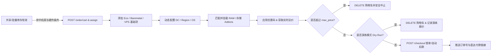

# 🎯 OVH Buyer (OVH Sniper) — 黑五 OVH 独服 / Eco / VPS 自动抢购与监控面板

[](https://github.com/AtomBoyC/ovh-buyer/actions/workflows/ci.yml)
[](https://www.python.org/)
[](#核心特性)
[](#二远程-linux-服务器-docker-部署)
[](LICENSE)

一款专为 **OVHcloud 黑五（Black Friday）/ 闪购 / 日常补货** 打造的高速、轻量、全功能自动抢购与监控系统，覆盖 **Eco（Kimsufi / SoYouStart / Rise / LE）**、**Baremetal（Advance / Game / Storage）** 与 **VPS** 全系列。

借鉴吸收了 `moonheart/OVH20251109`、`gokele/ovh`、`katorly/ovh-auto-buy` 等开源抢购脚本的实战经验，并对下单链路、部署复杂度、防坑保护与通知交互进行了全面重构。


---

## ✨ 核心特性

| 维度 | 特性说明 |
| :--- | :--- |
| **零依赖极简架构** | 纯 **Python 3.9+ 标准库**实现，无需 `pip install`、无需 Node.js、无需 Nginx 多容器。本地直接运行；Docker 单容器镜像仅 ~55MB、内存占用 ~25MB，512MB 小鸡轻松扛住黑五。 |
| **黑五单购物车直通下单** | 在**同一购物车**内完成建车 → 绑定 → 动态配置 → 硬件 Addons 自动匹配 → 优惠码 → 实时价格封顶校验 → Checkout，省去二次建车耗时，抢秒空特价机更快。 |
| **安全防坑机制** | 内置 **演练模式 (Dry-Run)**（实测鉴权、建车、配置与含税报价但不真实下单）、**价格封顶保护 (`max_price`)**（超预算自动删车取消）、**原子购买配额 (`max_orders`)** 防重复多买。 |
| **黑五新品雷达 & 配置狙击** | 持续扫描 OVH 官方 Eco 目录：新品上线雷达 (`new_sku`) 第一时间捕获 `26skle*` / `27skle*` / `bf` 等新机型；配置指纹狙击 (`config_match`) 支持 `>=32g`、`nvme` 等硬件条件跨型号自动发现并开抢。 |
| **批量合并轮询 & 智能限流** | 同区域监控 ≥ 3 个型号自动合并为 1 次全局库存请求，减少 80%+ API 调用；内置 QPS 令牌桶、Keep-Alive 连接池、`/auth/time` 自动时钟校偏与指数退避重试，避免触发 429 限流。 |
| **多账号 & 多区域** | 支持同时管理多个 OVH 账号（EU / CA / US；IE / FR / DE / GB / CA / SG / US），凭据支持静态加密存储（`DATA_ENCRYPTION_KEY`）与脱敏展示。 |
| **零域名 Telegram 交互 Bot** | 内置 **Long Polling**，无需公网 HTTPS 域名或 SSL 证书即可在手机上收到补货推送后点击内联按钮**一键抢购**，并支持 `/status`、`/tasks`、`/check`、`/orders`、`/pause`、`/resume`；同时支持 Bark、Server酱、钉钉（支持加签）、飞书、Discord、自定义 Webhook。 |
| **Web 控制台 + SSE 日志 + CLI** | 内置暗黑运维风 Web 面板（含密码/API-Key 访问门禁与 SSE 实时日志流），并支持无头模式（`--headless`）与命令行实时查货/查目录工具。 |

---

## 🧭 下单引擎流程



---

## 🚀 一、本地部署运行（macOS / Linux / Windows）

只需本机安装 **Python 3.9+**，无需安装任何第三方包：

```bash
git clone https://github.com/AtomBoyC/ovh-buyer.git
cd ovh-buyer

# macOS / Linux 一键启动
chmod +x scripts/start-local.sh
./scripts/start-local.sh

# Windows / 跨平台通用启动
python3 run.py
```

启动后浏览器访问：**`http://127.0.0.1:8888`**

> 💡 **免 API Key 体验**：启动后无需配置任何 OVH 密钥，即可直接在 **「目录与查货」** 或仪表盘 **「秒查实时库存」** 中拉取真实 OVH 官方商品目录与实时机房库存。

### 命令行快捷工具（CLI）

```bash
# 秒查指定型号在全球机房的实时库存
python3 run.py check 27skle01-v1 --endpoint ovh-eu

# 搜索 OVH Eco 官方目录（按不含税价格升序显示 CPU/核数/内存/存储/价格）
python3 run.py catalog --endpoint ovh-eu --subsidiary IE --search skle

# 查询 VPS 机房库存
python3 run.py vps vps-2025-model1 --endpoint ovh-eu --subsidiary IE

# 无头模式启动（仅后台引擎 + Telegram Bot，不开放 HTTP 端口）
python3 run.py --headless
```

---

## 🐳 二、远程 Linux 服务器 Docker 部署

### 方式 A：一键部署脚本（最省心）

```bash
git clone https://github.com/AtomBoyC/ovh-buyer.git
cd ovh-buyer
chmod +x scripts/deploy-docker.sh
./scripts/deploy-docker.sh
```

脚本会自动检测 Docker Compose、复制 `.env` 并生成 16 位强随机 `PANEL_PASSWORD`、构建轻量 Alpine 镜像并后台启动服务。

### 方式 B：标准 Docker Compose 部署

```bash
git clone https://github.com/AtomBoyC/ovh-buyer.git
cd ovh-buyer
cp .env.example .env
nano .env   # 强烈建议设置 PANEL_PASSWORD；可按需填写 OVH 密钥或 Telegram Token

docker compose up -d --build
docker compose logs -f
```

访问控制台：**`http://<你的服务器IP>:8888`**

### 常用维护命令

```bash
# 查看实时日志
docker compose logs -f ovh-sniper

# 更新到最新版本并重启（数据持久化在 ./data 目录，不会丢失）
git pull && docker compose up -d --build

# 停止并移除容器
docker compose down
```

### 方式 C：无头纯配置文件部署（适合极简 VPS）

1. 复制 `config.example.json` 到 `./data/config.json`，填入 OVH 凭据、抢购任务与黑五雷达规则
2. 在 `.env` 中设置 `HEADLESS=true`、`TELEGRAM_BOT_TOKEN` 与 `TELEGRAM_CHAT_ID`
3. 执行 `docker compose up -d --build`，全程通过 Telegram Bot 交互控制

### 公网安全建议（Caddy / Nginx 反代 HTTPS）

若需要将面板暴露至公网，请务必：
1. 在 `.env` 中设置强密码 `PANEL_PASSWORD`
2. 建议将 `docker-compose.yml` 端口映射改为 `127.0.0.1:8888:8888`，前置 Caddy 或 Nginx 提供 HTTPS（注意关闭 SSE 路径缓冲）：

```nginx
location / {
    proxy_pass http://127.0.0.1:8888;
    proxy_set_header Host $host;
    proxy_set_header X-Real-IP $remote_addr;
    proxy_http_version 1.1;
    proxy_buffering off;   # 保证 /api/logs/stream SSE 实时日志流顺畅
}
```

---

## 🔑 三、申请 OVH API 凭据

根据你的账号归属区域打开官方 Token 创建页登录：

| 区域 | API Endpoint | 常见子公司 Subsidiary | Token 申请地址 |
| :--- | :--- | :--- | :--- |
| 欧洲区 | `ovh-eu` | `IE`（热门）, `FR`, `DE`, `GB`, `ES`, `NL`, `PL` | https://eu.api.ovh.com/createToken/ |
| 加拿大 / 亚太区 | `ovh-ca` | `CA`, `SG`, `AU`, `ASIA`, `IN` | https://ca.api.ovh.com/createToken/ |
| 美国区 | `ovh-us` | `US` | https://api.us.ovhcloud.com/createToken/ |

**权限（Rights）建议勾选 4 项并均填写 `/*`**：
- `GET` `/*`
- `POST` `/*`
- `PUT` `/*`
- `DELETE` `/*`

有效期（Validity）选择 `30 days` 或 `Unlimited`。拿到 `Application Key`、`Application Secret`、`Consumer Key` 后，在 Web 面板 **「多账号管理」** 添加并点击 **「测试连通」**，即可验证 `nichandle` 与账户余额。

---

## 🤖 四、Telegram Bot 零域名交互与多渠道通知

在 Web 面板 **「通知与设置」** 中填写 `Telegram Bot Token` 与 `Chat ID`（支持英文逗号分隔多个 Chat ID），勾选 **「启用 Telegram Bot 交互指令 & 一键下单按钮」** 即可生效——**无需配置 Webhook、无需域名与 SSL 证书**。

| 命令 / 交互 | 功能说明 |
| :--- | :--- |
| `/status` | 查看抢购引擎、黑五雷达、VPS 监控状态与累计统计 |
| `/tasks` | 列出所有抢购任务、状态与已购配额 |
| `/check <planCode> [endpoint]` | 实时查询任意型号全球机房库存（如 `/check 27skle01-v1`） |
| `/orders` | 查看近期订单号与直达支付链接 |
| `/pause` / `/resume` | 一键暂停 / 恢复全局抢购引擎 |
| **内联按钮 `🛒 GRA 一键抢购`** | 收到补货推送后手机轻点一下，立刻创建高优先级任务开抢 |

除 Telegram 外，还支持同时推送至：**Bark（iOS 强提醒）**、**Server酱**、**钉钉（含加签）**、**飞书**、**Discord** 与 **自定义 JSON Webhook**。

---

## ⚙️ 五、环境变量一览

完整示例见 [.env.example](.env.example)：

| 变量名 | 默认值 | 说明 |
| :--- | :--- | :--- |
| `PORT` | `8888` | Web 控制台监听与 Docker 映射端口 |
| `HOST` | `0.0.0.0` | 监听地址 |
| `TZ` | `Asia/Shanghai` | 容器与日志时区 |
| `PANEL_PASSWORD` | 空 | 面板登录密码（也支持通过请求头 `X-API-Key` 调用接口） |
| `DATA_ENCRYPTION_KEY` | 空 | 可选：开启数据库内 OVH 凭据静态加密的密钥 |
| `OVH_DATA_DIR` | `./data` | SQLite 数据库与目录缓存存放路径 |
| `HEADLESS` | `false` | 设为 `true` 仅运行后台引擎与 Telegram Bot |
| `OVH_HTTP_PROXY` / `HTTPS_PROXY` | 空 | 全局 HTTP/HTTPS 代理（如 `http://127.0.0.1:7890`） |
| `TELEGRAM_BOT_TOKEN` / `TELEGRAM_CHAT_ID` | 空 | Telegram 机器人凭据与允许操控的 Chat ID |
| `OVH_ENDPOINT` / `OVH_SUBSIDIARY` / `OVH_APP_KEY` / `OVH_APP_SECRET` / `OVH_CONSUMER_KEY` | 空 | 可选：首次启动自动导入的默认 OVH 账号 |

---

## ⚡ 六、黑五实战避坑清单

1. **务必先跑演练模式 (Dry-Run)**：在任务里先勾选「演练模式」，点击任务右侧 **「演练」** 按钮，确认 API 签名、建车、配置、实时含税报价全部返回成功后再切回实单。
2. **支付方式准备**：
   - 开启 **自动扣款 (`auto_pay`)**：推荐提前绑定 **PayPal（免 3DS 验证）** 或提前向 OVH 账户充值 **Credit Balance**，避免信用卡 3D-Secure 验证中断自动支付。
   - 关闭自动扣款：锁单成功后会立即推送 **OVH 直达付款链接**，手机点开即可在订单有效期内完成支付。
3. **设置价格封顶 (`max_price`)**：黑五放货可能包含高配版（如大内存/多盘加价）或安装费，设定合理的预算上限，超价自动删车止损。
4. **控制轮询速率**：推荐全局 `global_qps = 3~5`，单任务 `3~5s` 轮询；监控 3 个以上型号时系统会自动合并为批量请求，既快又不易触发 OVH WAF 429。
5. **提前开启黑五新品雷达**：创建 `new_sku` 规则（如正则 `26skle|27skle|bf|sysle`）并打开顶部 **「黑五雷达」** 开关，首次扫描会记录当前目录基线，黑五上新瞬间告警并可自动开抢。

---

## 📂 项目结构

```text
ovh-buyer/
├── run.py                      # 统一入口（Web 控制台 / Headless / CLI 工具）
├── Dockerfile                  # 轻量单容器 Alpine 镜像 (~55MB)
├── docker-compose.yml          # Docker Compose 编排配置
├── .env.example                # 环境变量配置模板
├── config.example.json         # 声明式配置导入模板
├── scripts/
│   ├── start-local.sh          # 本地一键启动脚本
│   └── deploy-docker.sh        # 远程 Linux 服务器 Docker 一键部署脚本
├── ovh_buyer/
│   ├── config.py               # 区域/子公司/机房元数据与环境读取
│   ├── database.py             # 线程安全 SQLite WAL 存储与可选静态加密
│   ├── ovh_client.py           # 零依赖 OVH API 客户端（SHA-1 签名/校偏/连接池/限流）
│   ├── catalog.py              # 目录解析、CPU/内存/存储规格提取与配置指纹标准化
│   ├── order_engine.py         # 单购物车直通下单、价格封顶保护与 Dry-Run 引擎
│   ├── sniper.py               # 共享批量轮询队列、黑五雷达、VPS 监控调度器
│   ├── notifier.py             # 多渠道通知中心 + 零域名 Telegram Long Polling Bot
│   ├── auth.py                 # 密码门禁、PBKDF2 哈希与 HMAC 签名会话 Cookie
│   ├── web_server.py           # REST API + SSE 实时日志流 + 静态 SPA 服务
│   └── web/                    # 零 CDN 暗黑控制台前端 (HTML / CSS / JS)
├── tests/
│   └── test_core.py            # 完整单元测试与本地 Mock OVH API 端到端集成测试
└── .github/workflows/ci.yml    # GitHub Actions 自动测试与 Docker 构建验证
```

---

## 🧪 运行测试

```bash
python3 -m unittest discover -s tests -v
```

---

## ⚠️ 免责声明与许可证

- 本项目仅供学习交流与个人合法自动化管理 OVHcloud 账户使用，请遵守 OVHcloud 服务条款与 API 速率规范，合理设置轮询间隔。
- 自动下单与自动扣款涉及真实资金交易，强烈建议先使用 **演练模式 (Dry-Run)** 与 **价格封顶保护 (`max_price`)** 充分验证。
- 本项目基于 [MIT License](LICENSE) 开源。
