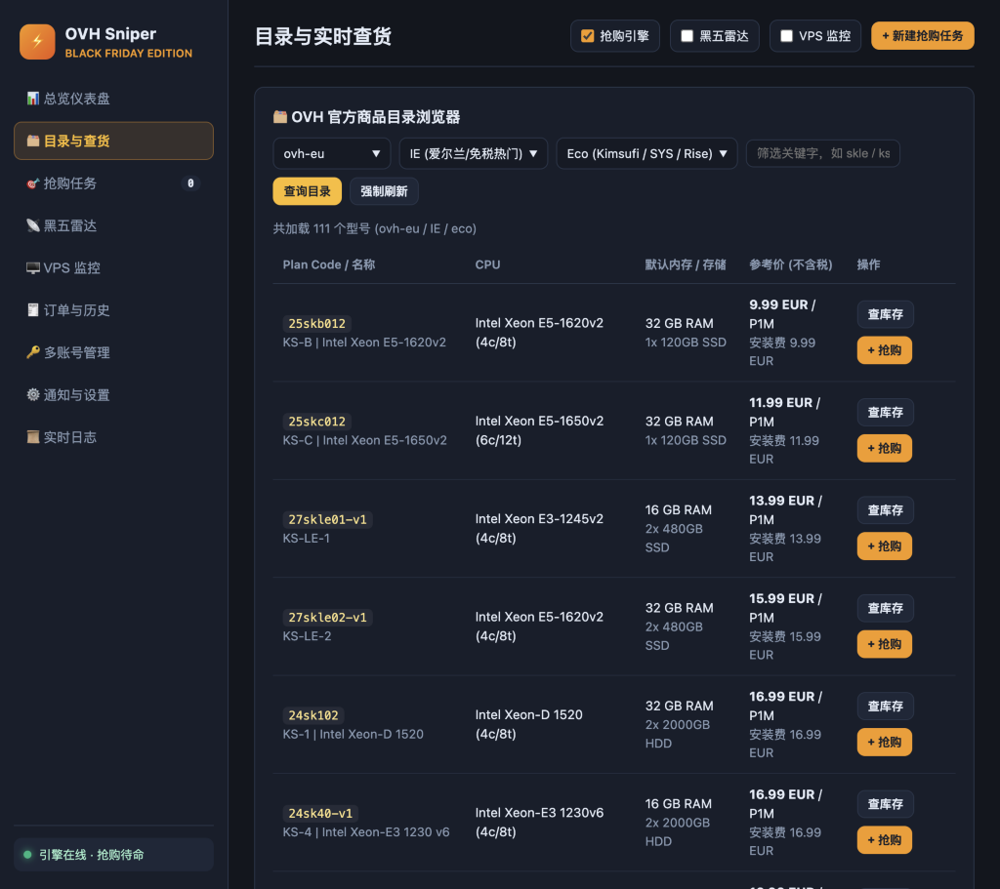
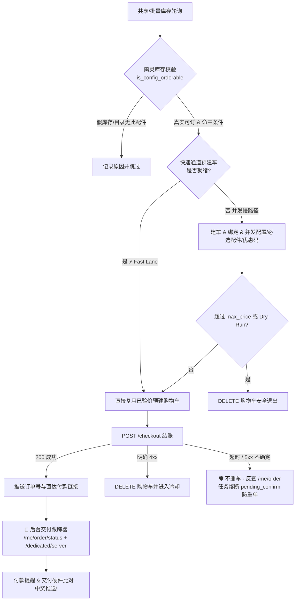

# 🎯 OVH Buyer (OVH Sniper) v2.0 — 黑五 OVH 独服 / Eco / VPS 自动抢购与监控面板

[](https://github.com/AtomBoyC/ovh-buyer/releases)
[](https://github.com/AtomBoyC/ovh-buyer/actions/workflows/ci.yml)
[](https://github.com/AtomBoyC/ovh-buyer/actions/workflows/docker-publish.yml)
[](https://hub.docker.com/r/atomboyc/ovh-buyer)
[](https://github.com/AtomBoyC/ovh-buyer/pkgs/container/ovh-buyer)
[](https://www.python.org/)
[](#核心特性)
[](LICENSE)

一款专为 **OVHcloud 黑五（Black Friday）/ 闪购 / 日常补货** 打造的高速、轻量、全功能自动抢购与监控系统，覆盖 **Eco（Kimsufi / SoYouStart / Rise / LE）**、**Baremetal（Advance / Game / Storage）** 与 **VPS** 全系列。

深度吸收了 `moonheart/OVH20251109`、`gokele/ovh`、`katorly/ovh-auto-buy` 以及 NodeSeek 社区最新实战项目 `super888-png/stockhawk-ovh`、`PoorVPS/ovh-eco-telegram-order-bot` 的架构精华，在保持 **纯 Python 3.9+ 零第三方依赖** 的前提下，全面升级至 **v2.0.0**（完整变更见 [CHANGELOG.md](CHANGELOG.md)）。



---

## ✨ 核心特性（v2.0.0 全面进化）

| 维度 | 特性说明 |
| :--- | :--- |
| **零依赖极简架构** | 纯 **Python 3.9+ 标准库**实现，无需 `pip install`、无需 Node.js、无需 Nginx 多容器。本地直接运行；Docker 单容器镜像仅 ~55MB、内存占用 ~25MB，支持 **v1.0 → v2.0 SQLite 自动无痛迁移**。 |
| **⚡ 预建购物车快速通道** | **v2.0 新增**：为开启快速通道的任务提前建好并绑定购物车、写入配置/配件与实时验价（后台自动保活与到期前无缝重建）。补货瞬间跳过建车步骤，**1 次 API 请求（`POST /checkout`）秒速结账**；常规建车亦升级为多线程并发挂载配置与配件。 |
| **🛡️ 结账超时防重单熔断** | **v2.0 新增**：区分明确拒绝（4xx，立即释放购物车）与不确定异常（超时/断连/5xx）。结账超时绝不盲目重试或删车，自动反查 `/me/order`，立即将任务熔断暂停为 `pending_confirm` 并紧急告警；配合 **Dry-Run 演练**、**价格封顶 (`max_price`)**、**原子配额 (`max_orders`)** 四重防坑。 |
| **👻 幽灵库存识别过滤** | **v2.0 新增**：交叉校验库存 FQN 与 OVH 官方目录（如过滤 `27skle03-v1` 等假库存），拒绝静默降级到默认配件；自动补齐 `mandatory` 必选配件家族（如 `bandwidth-*`）并取主商品与配件的公共周期交集；支持 `allow_non_default` 仅抢标配。 |
| **🎰 交付跟踪 & 硬件中奖检测** | **v2.0 新增**：后台自动追踪已下订单状态（`未付款 → 核查中 → 交付中 → 已交付`），付款与交付节点自动通知；交付后自动拉取实机硬件对比官方目录标配，内存扩容 / 硬盘升 NVMe 或扩容 / CPU 升级立即推送 **「🎰 恭喜中奖」** 喜报！ |
| **💱 实时人民币估价** | **v2.0 新增**：内置 ECB/Frankfurter 汇率（带离线兜底），在目录浏览、订单历史、短链预览、Telegram 补货/下单推送中自动附带人民币参考价（`≈ ¥xxx`）。 |
| **📣 Telegram 2.0 交互体验** | **零域名 Long Polling**，无需公网 HTTPS 与证书！**v2.0 升级**：HTML 补货卡片 + **OVH 官网 Express 一键直达按钮** + API 一键抢购按钮；库存售罄后**自动编辑原消息划上删除线（`已被抢完`）**；新增 `/order <短链>` 与 `/servers` 指令。同时支持 Bark、Server酱、钉钉（含加签）、飞书、Discord、自定义 Webhook。 |
| **🔗 `@ovheco` 短链本地解码下单** | **v2.0 新增**：支持在 Web 控制台或 Telegram `/order` 中直接粘贴 `@ovheco` 频道的 `/o/<region>/<token>` 补货短链，纯本地 Raw Deflate 解码（不访问第三方服务器），实时建车展示含税价，二次确认后生成官方未付款订单（带防双击重复提交锁）。 |
| **🛡️ 最小权限 Token & 支付体检** | **v2.0 新增**：Web 面板内置 EU/CA/US 最小权限预填申请链接（绝不申请删机/重启权限）；点击「测试连通」同步检查 `/me/payment/method` 默认支付方式绑定状态。 |
| **📡 黑五雷达 & VPS 监控** | 持续扫描 OVH 官方 Eco 目录：新品上线雷达 (`new_sku`) 捕获 `26skle*` / `27skle*` / `bf` 等新机型；配置指纹狙击 (`config_match`) 支持 `>=32g`、`nvme` 跨型号发现；批量合并轮询（≥3 型号合并 1 次全局请求）+ QPS 令牌桶 + `/auth/time` 校偏。 |

---

## 🧭 v2.0 下单与追踪引擎流程



---

## 🚀 一、本地部署运行（macOS / Linux / Windows）

只需本机安装 **Python 3.9+**，无需安装任何第三方依赖包：

```bash
git clone https://github.com/AtomBoyC/ovh-buyer.git
cd ovh-buyer

# macOS / Linux 一键启动
chmod +x scripts/start-local.sh
./scripts/start-local.sh

# Windows / 跨平台通用启动
python3 run.py
```

启动后浏览器访问：**`http://127.0.0.1:8888`**

> 💡 **免 API Key 体验**：启动后无需配置任何 OVH 密钥，即可直接在 **「目录与查货」** 或仪表盘 **「秒查实时库存」** 中拉取真实 OVH 官方商品目录（带人民币估价）、识别幽灵库存并一键打开 OVH 官网 Express 结账页。

### 命令行快捷工具（CLI）

```bash
# 秒查指定型号在全球机房的实时库存
python3 run.py check 27skle01-v1 --endpoint ovh-eu

# 搜索 OVH Eco 官方目录（按不含税价格升序显示 CPU/核数/内存/存储/价格）
python3 run.py catalog --endpoint ovh-eu --subsidiary IE --search skle

# 查询 VPS 机房库存
python3 run.py vps vps-2025-model1 --endpoint ovh-eu --subsidiary IE

# 无头模式启动（仅后台引擎 + Telegram Bot，不开放 HTTP 端口）
python3 run.py --headless
```

---

## 🐳 二、远程 Linux 服务器 Docker 部署

每次推送到 `main` 分支或发布 [GitHub Release](https://github.com/AtomBoyC/ovh-buyer/releases) 标签时，GitHub Actions 均会自动构建并同步推送 **双架构预构建镜像（`linux/amd64` + `linux/arm64`）** 到以下两个公开仓库，按服务器网络任选其一即可：

| 镜像仓库 | 最新版镜像 (`latest`) | 稳定版标签 (`v2.0.0`) | 仓库主页 |
| :--- | :--- | :--- | :--- |
| **GHCR** | `ghcr.io/atomboyc/ovh-buyer:latest` | `ghcr.io/atomboyc/ovh-buyer:2.0.0` | [GitHub Packages](https://github.com/AtomBoyC/ovh-buyer/pkgs/container/ovh-buyer) |
| **Docker Hub** | `atomboyc/ovh-buyer:latest` | `atomboyc/ovh-buyer:2.0.0` | [Docker Hub](https://hub.docker.com/r/atomboyc/ovh-buyer) |

### 方式 A：免 `git clone`，一条 `docker run` 秒级启动（最快捷）

```bash
mkdir -p ~/ovh-buyer/data && cd ~/ovh-buyer

# 从 Docker Hub 拉取（也可把最后一行替换为 ghcr.io/atomboyc/ovh-buyer:latest）
docker run -d \
  --name ovh-sniper \
  --restart unless-stopped \
  -p 8888:8888 \
  -e TZ=Asia/Shanghai \
  -e PANEL_PASSWORD="请改成你的强密码" \
  -v $(pwd)/data:/app/data \
  atomboyc/ovh-buyer:latest
```

### 方式 B：免 `git clone`，仅下载 `docker-compose.yml` 部署（推荐）

可直接从 [Releases 页面](https://github.com/AtomBoyC/ovh-buyer/releases/latest) 或下方命令下载编排文件：

```bash
mkdir -p ~/ovh-buyer && cd ~/ovh-buyer
curl -fsSLO https://raw.githubusercontent.com/AtomBoyC/ovh-buyer/main/docker-compose.yml
curl -fsSLO https://raw.githubusercontent.com/AtomBoyC/ovh-buyer/main/.env.example
cp .env.example .env
nano .env   # 修改 PANEL_PASSWORD（强烈建议）；如需从 Docker Hub 拉取可取消注释 OVH_IMAGE=atomboyc/ovh-buyer:latest

docker compose pull && docker compose up -d
docker compose logs -f
```

访问控制台：**`http://<你的服务器IP>:8888`**

### 方式 C：克隆仓库一键脚本部署（支持自动拉取或 `--build` 本地构建）

```bash
git clone https://github.com/AtomBoyC/ovh-buyer.git
cd ovh-buyer
chmod +x scripts/deploy-docker.sh

# 默认直接拉取预构建镜像启动（自动生成 16 位随机强密码）
./scripts/deploy-docker.sh

# 若想从 Docker Hub 拉取：
OVH_IMAGE=atomboyc/ovh-buyer:latest ./scripts/deploy-docker.sh

# 若修改了源码想本地构建：
./scripts/deploy-docker.sh --build
```

### 从 v1.0.0 无痛升级到 v2.0.0 & 常用维护

```bash
# 直接拉取最新镜像并重启 —— SQLite 数据库会自动迁移至 v2.0，账号/任务/历史记录零丢失！
docker compose pull && docker compose up -d

# 查看实时日志
docker compose logs -f ovh-sniper

# 停止并移除容器
docker compose down
```

### 方式 D：无头纯配置文件部署（适合极简 VPS）

1. 复制 `config.example.json` 到 `./data/config.json`，填入 OVH 凭据、抢购任务与黑五雷达规则
2. 在 `.env` 中设置 `HEADLESS=true`、`TELEGRAM_BOT_TOKEN` 与 `TELEGRAM_CHAT_ID`
3. 执行 `docker compose up -d`，全程通过 Telegram Bot 交互控制

> 💡 **Fork 二次开发自动发布说明**：[docker-publish.yml](.github/workflows/docker-publish.yml) 默认自动推送至你的 GHCR；若也想同步推送至你自己的 Docker Hub，在仓库 `Settings → Secrets → Actions` 添加 `DOCKERHUB_USERNAME` 与 `DOCKERHUB_TOKEN` 即可自动启用双推。

### 公网安全建议（Caddy / Nginx 反代 HTTPS）

若需要将面板暴露至公网，请务必：
1. 在 `.env` 中设置强密码 `PANEL_PASSWORD`
2. 建议将 `docker-compose.yml` 端口映射改为 `127.0.0.1:8888:8888`，前置 Caddy 或 Nginx 提供 HTTPS（注意关闭 SSE 路径缓冲）：

```nginx
location / {
    proxy_pass http://127.0.0.1:8888;
    proxy_set_header Host $host;
    proxy_set_header X-Real-IP $remote_addr;
    proxy_http_version 1.1;
    proxy_buffering off;   # 保证 /api/logs/stream SSE 实时日志流顺畅
}
```

---

## 🔑 三、申请 OVH API 凭据（v2.0 最小权限推荐）

打开 Web 面板 **「多账号管理」**，直接点击对应区域的 **「最小权限一键申请 ↗」** 链接即可自动预填以下 8 条安全权限（**绝不申请任何删机、重装、重启或修改账号资料的危险权限**）：

- `GET /me`、`GET /me/*`（读取账户信息、余额、订单状态、默认支付方式）
- `GET /order/*`、`POST /order/*`、`PUT /order/*`、`DELETE /order/*`（建车、配参、查价、结账、删临时车）
- `GET /dedicated/server`、`GET /dedicated/server/*`（只读查询已交付独服硬件配置，用于中奖比对与 `/servers`）

| 区域 | API Endpoint | 常见子公司 Subsidiary | 手动申请入口 |
| :--- | :--- | :--- | :--- |
| 欧洲区 | `ovh-eu` | `IE`（免税热门）, `FR`, `DE`, `GB`, `ES`, `NL`, `PL` | https://eu.api.ovh.com/createToken/ |
| 加拿大 / 亚太区 | `ovh-ca` | `CA`, `SG`, `AU`, `ASIA`, `IN` | https://ca.api.ovh.com/createToken/ |
| 美国区 | `ovh-us` | `US` | https://api.us.ovhcloud.com/createToken/ |

有效期（Validity）建议选择 `30 days` 或 `Unlimited`。添加账号后点击 **「测试连通」**，系统会同时校验 `nichandle`、账户余额及 **是否已绑定默认支付方式**（如 `💳 PAYPAL`）。

---

## 🤖 四、Telegram Bot 2.0 零域名交互与多渠道通知

在 Web 面板 **「通知与设置」** 中填写 `Telegram Bot Token` 与 `Chat ID`（支持英文逗号分隔多个 Chat ID），勾选 **「启用 Telegram Bot 交互指令 & 一键下单按钮」** 即可生效——**无需配置 Webhook、无需域名与 SSL 证书**。

| 命令 / 交互 | 功能说明 |
| :--- | :--- |
| `/status` | 查看抢购引擎、快速通道、交付跟踪、黑五雷达、VPS 监控状态与统计 |
| `/tasks` | 列出所有抢购任务、快速通道标记（`⚡`）、状态（含 `⚠️ pending_confirm`）与配额 |
| `/check <planCode> [endpoint]` | 实时查询任意型号全球机房库存并标记幽灵库存（如 `/check 27skle01-v1`） |
| `/order <短链>` | **v2.0 新增**：粘贴 `@ovheco` 的 `/o/e/...` 补货短链，实时建车报含税价 & 人民币估价，点确认生成未付款订单 |
| `/servers` | **v2.0 新增**：只读查看当前账号名下已交付的独立服务器（机房 / IP / CPU / 内存 / 到期时间） |
| `/orders` | 查看近期订单号与直达支付链接 |
| `/pause` / `/resume` | 一键暂停 / 恢复全局抢购引擎 |
| **内联按钮 `🛒 GRA 一键抢购` / `🌐 GRA 官网直达`** | 补货 HTML 卡片附带 API 抢购与 OVH Express 直达双按钮；**售罄后自动将原卡片划删除线并标记「已被抢完」** |

除 Telegram 外，还支持同时推送至：**Bark（iOS 强提醒）**、**Server酱**、**钉钉（含加签）**、**飞书**、**Discord** 与 **自定义 JSON Webhook**。

---

## ⚙️ 五、环境变量一览

完整示例见 [.env.example](.env.example)：

| 变量名 | 默认值 | 说明 |
| :--- | :--- | :--- |
| `OVH_IMAGE` | `ghcr.io/atomboyc/ovh-buyer:latest` | Docker Compose 拉取的镜像地址（可改为 `atomboyc/ovh-buyer:latest` 或指定版本 `:2.0.0`） |
| `PORT` | `8888` | Web 控制台监听与 Docker 映射端口 |
| `HOST` | `0.0.0.0` | 监听地址 |
| `TZ` | `Asia/Shanghai` | 容器与日志时区 |
| `PANEL_PASSWORD` | 空 | 面板登录密码（也支持通过请求头 `X-API-Key` 调用接口） |
| `DATA_ENCRYPTION_KEY` | 空 | 可选：开启数据库内 OVH 凭据静态加密的密钥 |
| `OVH_DATA_DIR` | `./data` | SQLite 数据库与目录缓存存放路径 |
| `HEADLESS` | `false` | 设为 `true` 仅运行后台引擎与 Telegram Bot |
| `OVH_HTTP_PROXY` / `HTTPS_PROXY` | 空 | 全局 HTTP/HTTPS 代理（如 `http://127.0.0.1:7890`） |
| `TELEGRAM_BOT_TOKEN` / `TELEGRAM_CHAT_ID` | 空 | Telegram 机器人凭据与允许操控的 Chat ID |
| `OVH_ENDPOINT` / `OVH_SUBSIDIARY` / `OVH_APP_KEY` / `OVH_APP_SECRET` / `OVH_CONSUMER_KEY` | 空 | 可选：首次启动自动导入的默认 OVH 账号 |

---

## ⚡ 六、黑五实战避坑清单

1. **务必先跑演练模式 (Dry-Run)**：在任务里先勾选「演练模式」，点击任务右侧 **「演练」** 按钮，确认 API 签名、建车、配置、必选配件与实时含税报价全部返回成功后再切回实单。
2. **秒空热款请开启 ⚡ 快速通道 (`fast_lane`)**：为重点目标（如 `KS-LE-1/2/3`、`KS-LE-B`）明确勾选 1~3 个核心机房并开启「预建购物车快速通道」，任务列表显示 `⚡ 预建就绪: GRA(55m)` 即表示购物车已热备，放货瞬间 1 次请求直接结账！
3. **正确处理 `⚠️ 待核对(防重单)` 状态**：黑五高峰期 OVH 偶发 504/超时，若触发 `pending_confirm` 熔断，请先登录 OVH 后台（或点「同步官方账号最近订单」）核实是否已生成订单，确认未成单再点击 **「核对后恢复」**，千万不要盲目新建重复任务。
4. **支付方式准备**：
   - 开启 **自动扣款 (`auto_pay`)**：强烈推荐提前绑定 **PayPal（免 3DS 验证）** 或充值 **Credit Balance**，并在「多账号管理」点击「测试连通」确认显示 `💳 PAYPAL` 等默认支付标识。
   - 关闭自动扣款：锁单成功后会立即推送 **OVH 直达付款链接**，付款后后台交付跟踪器会自动跟进交付与中奖比对。
5. **善用价格封顶 (`max_price`) 与仅抢标配 (`allow_non_default`)**：防止高价加配版或高额安装费误下单；幽灵库存保护默认全局生效。
6. **控制轮询速率**：推荐全局 `global_qps = 3~5`，单任务 `3~5s` 轮询；监控 ≥3 个型号时系统自动合并为单次批量请求，快且不易触发 OVH WAF 429。

---

## 📂 项目结构

```text
ovh-buyer/
├── run.py                      # 统一入口（Web 控制台 / Headless / CLI 工具）
├── Dockerfile                  # 轻量单容器 Alpine 镜像 (~55MB)
├── docker-compose.yml          # Docker Compose 编排配置（默认拉取预构建镜像）
├── docker-compose.build.yml    # 本地源码构建覆盖配置
├── CHANGELOG.md                # 版本更新日志（v2.0.0 / v1.0.0）
├── .env.example                # 环境变量配置模板
├── config.example.json         # 声明式配置导入模板
├── scripts/
│   ├── start-local.sh          # 本地一键启动脚本
│   └── deploy-docker.sh        # 远程 Linux 服务器 Docker 一键部署脚本
├── ovh_buyer/
│   ├── config.py               # 最小权限 Token、Express JSURL、短链解码与区域元数据
│   ├── database.py             # 线程安全 SQLite WAL 存储、v1→v2 自动迁移与静态加密
│   ├── ovh_client.py           # 零依赖 OVH API 客户端（签名/校偏/连接池/限流/支付与独服查询）
│   ├── catalog.py              # 目录解析、幽灵库存过滤、必选配件补齐与公共周期交集
│   ├── specs.py                # 实时汇率转换与官方/实机硬件「中奖」规格比对引擎
│   ├── order_engine.py         # 预建快速通道 CartSlotPool、并发建车与超时防重单熔断引擎
│   ├── tracker.py              # 订单付款/交付后台只读跟踪器与硬件中奖推送
│   ├── sniper.py               # 共享批量轮询队列、快速通道维护、黑五雷达、VPS 监控调度器
│   ├── notifier.py             # 多渠道通知中心 + Telegram 2.0 HTML 卡片/售罄划线/短链下单 Bot
│   ├── auth.py                 # 密码门禁、PBKDF2 哈希与 HMAC 签名会话 Cookie
│   ├── web_server.py           # REST API + SSE 实时日志流 + 静态 SPA 服务
│   └── web/                    # 零 CDN 暗黑控制台前端 v2.0 (HTML / CSS / JS)
├── tests/
│   └── test_core.py            # 14 项单元测试与本地 Mock OVH API 端到端集成测试
└── .github/workflows/
    ├── ci.yml                  # GitHub Actions 自动测试与 Docker 构建验证
    └── docker-publish.yml      # 双架构自动发布至 GHCR 与 Docker Hub
```

---

## 🧪 运行测试

```bash
python3 -m unittest discover -s tests -v
```

---

## ⚠️ 免责声明与许可证

- 本项目仅供学习交流与个人合法自动化管理 OVHcloud 账户使用，请遵守 OVHcloud 服务条款与 API 速率规范，合理设置轮询间隔。
- 自动下单与自动扣款涉及真实资金交易，强烈建议先使用 **演练模式 (Dry-Run)** 与 **价格封顶保护 (`max_price`)** 充分验证。
- 本项目基于 [MIT License](LICENSE) 开源。
