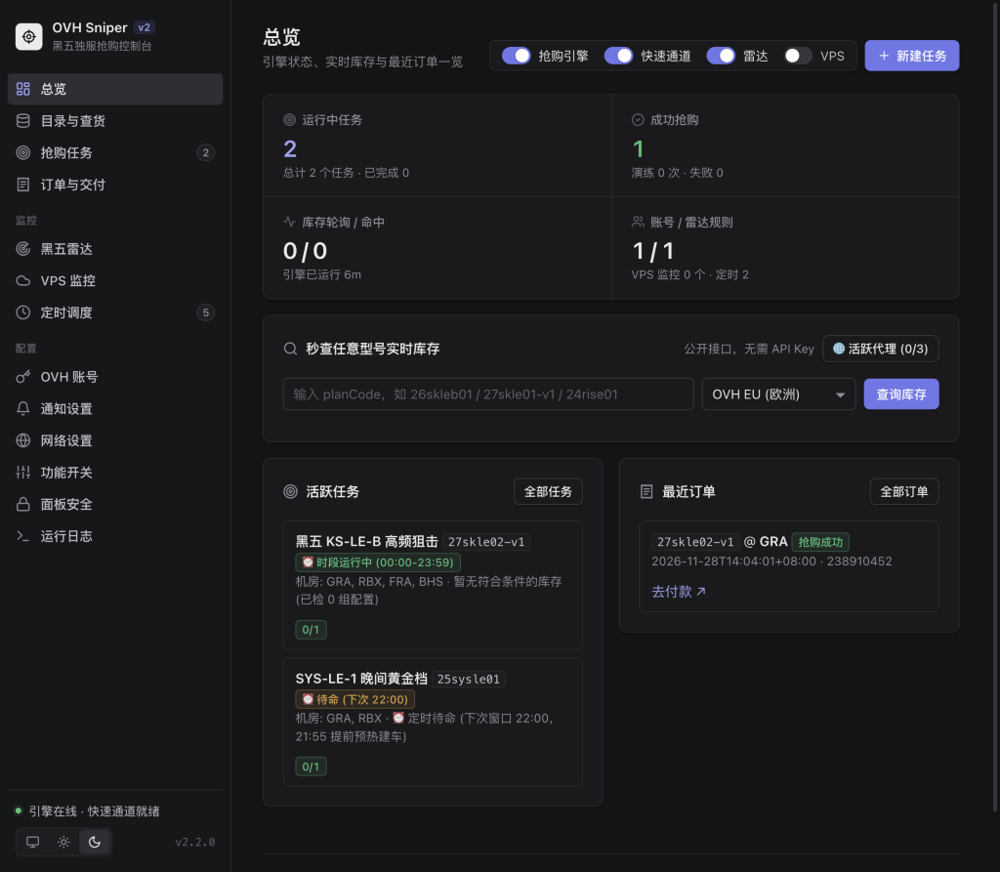
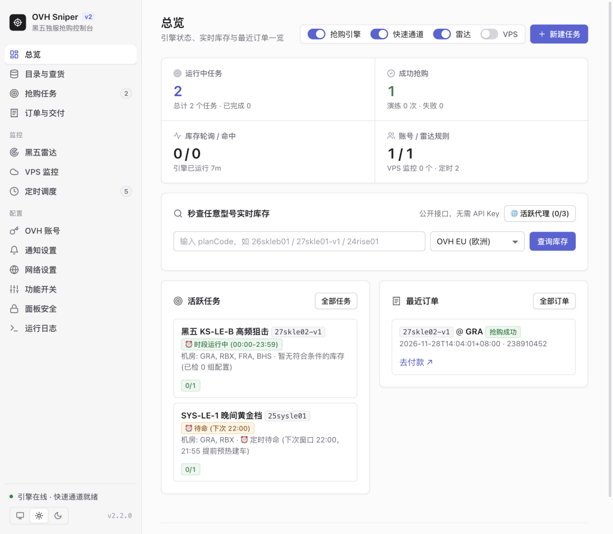
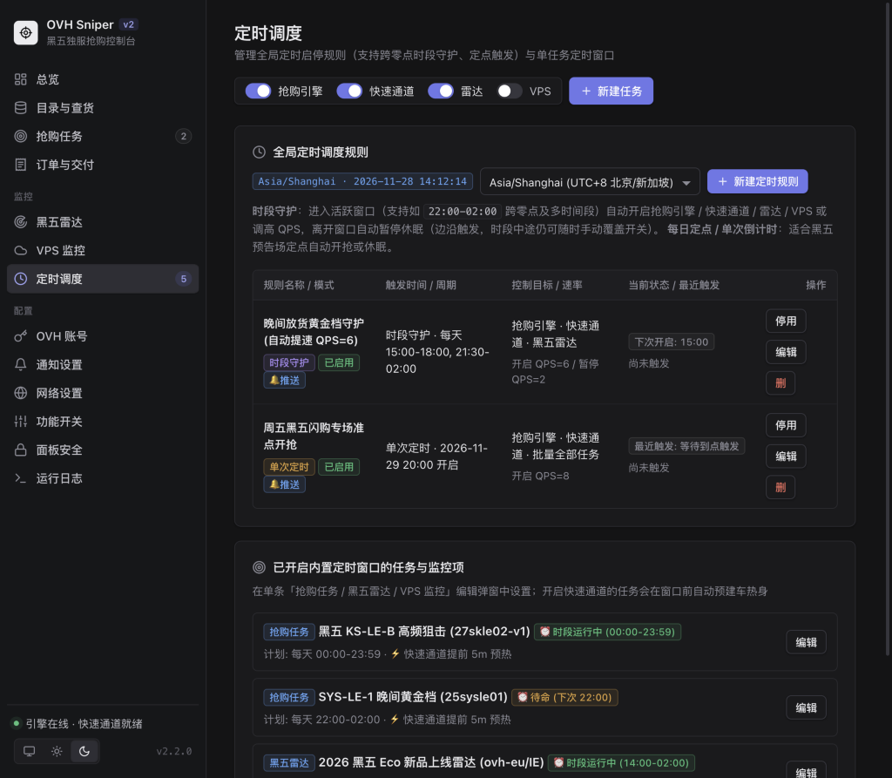
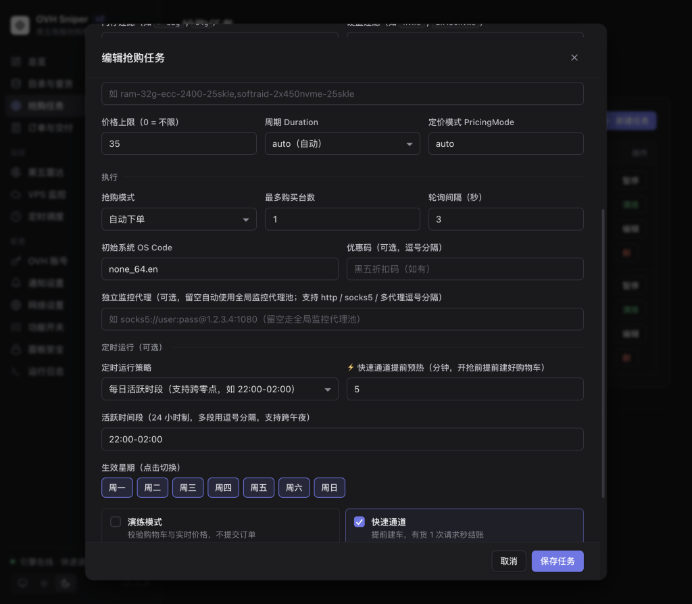
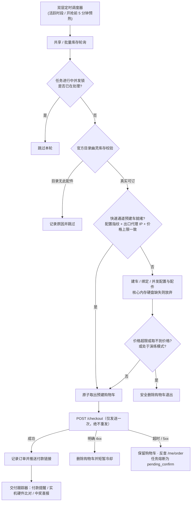

# 🎯 OVH Buyer (OVH Sniper) — OVH 独服 / Eco / VPS 自动抢购与监控面板

> 🌐 **语言 / Language**: **[English](README.md)** | **简体中文**

[](https://github.com/AtomBoyC/ovh-buyer/releases)
[](https://github.com/AtomBoyC/ovh-buyer/actions/workflows/ci.yml)
[](https://github.com/AtomBoyC/ovh-buyer/actions/workflows/docker-publish.yml)
[](https://hub.docker.com/r/atomboyc/ovh-buyer)
[](https://github.com/AtomBoyC/ovh-buyer/pkgs/container/ovh-buyer)
[](https://www.python.org/)
[](#-核心特性)
[](LICENSE)

专为 **OVHcloud 黑五 / 闪购 / 日常补货** 打造的自动抢购与监控系统，覆盖 **Eco（Kimsufi / SoYouStart / Rise / KS-LE）**、**Baremetal（Advance / Game / Storage）** 与 **VPS** 全产品线。

- **纯 Python 3.9+ 标准库，零第三方依赖**：本地 `python3 run.py` 直接运行，无需 `pip install` 或 Node.js；Alpine 双架构 Docker 单容器镜像约 55MB。
- **资金安全第一**：演练模式、严格价格封顶（价格未知一律禁买）、结账请求绝不重发、超时/5xx `pending_confirm` 熔断防重单、任务级并发锁、硬件不降级。
- **双层定时调度 + 两级自动优选代理池**：支持每日跨零点活跃窗口与黑五闪购定点倒计时（**⚡ 快速通道开抢前 5 分钟自动预热建车**），配合后台逐条静默测速的 `HTTP / HTTPS / SOCKS5` 监控代理池。

完整英文变更日志见 [CHANGELOG.md](CHANGELOG.md)。

| 深色主题（总览） | 浅色主题（总览） |
| :---: | :---: |
|  |  |
| **双层定时调度中心（`定时调度`）** | **单任务跨零点活跃窗口 & 快速通道预热** |
|  |  |

---

## 📌 目录

- [v2.2.0 更新亮点](#-v220-更新亮点)
- [核心特性](#-核心特性)
- [下单与安全引擎流程](#-下单与安全引擎流程)
- [一、本地快速运行（macOS / Linux / Windows）](#-一本地快速运行macos--linux--windows)
- [二、Linux 服务器 Docker 部署](#-二linux-服务器-docker-部署)
- [三、申请 OVH API 凭据（最小权限）](#-三申请-ovh-api-凭据最小权限)
- [四、Web 控制台页面指南](#-四web-控制台页面指南)
- [五、双层定时抢购与监控调度](#-五双层定时抢购与监控调度)
- [六、两级自动优选监控代理池](#-六两级自动优选监控代理池)
- [七、Telegram Bot（含群组话题）与多渠道通知](#-七telegram-bot含群组话题与多渠道通知)
- [八、资金与面板安全机制](#-八资金与面板安全机制)
- [九、环境变量说明](#-九环境变量说明)
- [十、黑五实战清单与常见问题（含 Cloudflare Tunnel 排障）](#-十黑五实战清单与常见问题含-cloudflare-tunnel-排障)
- [版本与分支](#-版本与分支) · [项目结构](#-项目结构) · [运行测试](#-运行测试)

---

## 🆕 v2.2.0 更新亮点

- **⏰ 双层定时抢购与监控调度系统（`ovh_buyer/scheduler.py`）**：
  - **单任务 / 雷达 / VPS 内置定时策略**：在编辑弹窗内直接选择 `全天候`、`每日活跃时段`（支持多时间段与跨零点，如 `15:00-18:00, 22:00-02:00` + 星期选择）或 `指定起止日期时间`（闪购定点开抢、到点自动暂停）。
  - **⚡ 快速通道提前预热**：开启快速通道的定时任务，会在窗口开启前 **提前 5 分钟（可配）自动预建并验好购物车**，开抢第 1 秒即可单次请求秒结账；非活跃时段零轮询、不耗代理。
  - **全局「定时调度」中心与 Telegram `/schedule` 指令**：支持多时区（`Asia/Shanghai`、`Europe/Paris`、`America/New_York`、`UTC` 等）配置 **时段守护**（边沿触发，进入时段开启模块并调高 QPS，离开时段自动休眠，不干扰中途手动开关，且绝不误恢复 `待核对` 熔断任务）、**每日定点** 与 **单次倒计时** 规则。
- **🌐 全链路代理底层重构与两级自动代理池加固**：
  - 基于标准库 `ssl.MemoryBIO` 实现真正的 **`https://` 代理嵌套 TLS（TLS-in-TLS）** 并彻底消除握手异常 Socket 句柄泄漏；透传代理隧道 `403 / 407 / 429` 状态码实现坏节点秒踢。
  - **OVH API、Telegram Bot、全部 Webhook 推送、实时汇率换算与 CLI 命令行** 全面统一支持 `http://`、`https://`、`socks5://`、`socks5h://` 及 `[scheme://]ip:port:user:pass` 简写格式。
- **🔐 静态加密扩展与代理密码无感脱敏回显**：
  - `DATA_ENCRYPTION_KEY` 静态加密现已完整覆盖代理配置、任务/账号代理与所有通知 Token/Webhook；REST 接口返回代理列表时自动隐藏密码（`:****@`），面板编辑保存或点「测速验证」时自动保留未改动的原密码；快速通道预建车指纹绑定出口代理 IP，杜绝建车与结账出口不一致。
- **⚡ 亚秒级闪购轮询优化**：支持 `0 ~ 0.9s` 超高频轮询（底层 `0.05s` 调度精度），并在无库存变化时自动节流 SQLite 磁盘写入。

---

## ✨ 核心特性

| 模块 | 说明 |
| :--- | :--- |
| **零依赖架构** | 纯 Python 3.9+ 标准库 + 原生 HTML/CSS/JS，零 CDN 外链；SQLite WAL 存储，v1.0 → v2.2 启动自动无痛迁移。 |
| **⚡ 预建购物车快速通道** | 为目标机房（最多 6 个）提前建好、配好、验好价的购物车并自动续期；补货瞬间仅需 **1 次 `POST /checkout`**。 |
| **⏰ 双层定时调度** | 任务/雷达/VPS 独立时间窗 + 快速通道提前 5 分钟建车热身 + 全局定时启停与高低峰 QPS 自动切换。 |
| **🌐 两级自动优选代理池** | 代理总池 → 后台逐条串行随机间隔（`1.5s~4.0s`）静默测速 → 自动挑选延迟最低 Top-N 进活跃池；故障秒换最快候补，支持严禁回退防漏本机 IP。 |
| **🛡️ 结账防重单熔断** | 明确 4xx 立即删车；超时 / 断连 / 5xx **绝不重发、不删车**，反查 `/me/order` 并熔断为 `pending_confirm` 紧急告警。 |
| **👻 幽灵库存过滤** | 交叉校验库存 FQN 与官方目录（过滤如 `27skle03-v1` 不可订假库存），自动补齐必选 `bandwidth-*` 配件，支持「仅抢默认标配」。 |
| **🎰 交付跟踪 & 硬件中奖** | 自动追踪 `未付款 → 已付款 → 已交付`，关联已开通主机并比对实机 CPU / 内存 / NVMe 硬盘，免费升级自动推送「恭喜中奖」。 |
| **📣 零域名 Telegram Bot** | 内置 Long Polling，支持超级群组指定 **Topic（话题）** 推送、HTML 补货卡片、售罄自动划删除线、`@ovheco` 短链本地解码报价下单。 |

---

## 🧭 下单与安全引擎流程



---

## 🚀 一、本地快速运行（macOS / Linux / Windows）

只需系统装有 **Python 3.9+**，无需安装任何第三方包：

```bash
git clone https://github.com/AtomBoyC/ovh-buyer.git
cd ovh-buyer

# macOS / Linux
chmod +x scripts/start-local.sh
./scripts/start-local.sh

# Windows / 通用方式
python3 run.py
```

浏览器打开 **http://127.0.0.1:8888** 即可使用。

> [!TIP]
> 不配置任何 OVH API 密钥也可以直接使用「目录与查货」和「秒查任意型号实时库存」。

### 命令行快捷工具

```bash
python3 run.py check 27skle01-v1 --endpoint ovh-eu                    # 秒查某型号各机房库存
python3 run.py catalog --endpoint ovh-eu --subsidiary IE --search skle # 搜索 Eco 目录（按价格排序）
python3 run.py vps vps-2025-model1 --endpoint ovh-eu --subsidiary IE   # 查询 VPS 各机房库存
python3 run.py serve --headless                                        # 无头模式（仅后台引擎 + Telegram Bot）
```

---

## 🐳 二、Linux 服务器 Docker 部署

每次发版自动构建 `linux/amd64` 与 `linux/arm64` 双架构镜像并同步推送到 **GHCR** 与 **Docker Hub**：

- GHCR：`ghcr.io/atomboyc/ovh-buyer:latest` / `ghcr.io/atomboyc/ovh-buyer:2.2.0`
- Docker Hub：`atomboyc/ovh-buyer:latest` / `atomboyc/ovh-buyer:2.2.0`

### 方式 A：一键部署脚本（推荐）

```bash
git clone https://github.com/AtomBoyC/ovh-buyer.git
cd ovh-buyer
chmod +x scripts/deploy-docker.sh
./scripts/deploy-docker.sh
```

首次运行会自动生成 `.env` 与 16 位随机 `PANEL_PASSWORD`、初始化 `./data` 目录权限、拉取预构建镜像启动并打印登录密码。

### 方式 B：免克隆单文件 `docker-compose.yml`

```bash
mkdir ovh-buyer && cd ovh-buyer
curl -fsSLO https://raw.githubusercontent.com/AtomBoyC/ovh-buyer/main/docker-compose.yml
curl -fsSLO https://raw.githubusercontent.com/AtomBoyC/ovh-buyer/main/.env.example
cp .env.example .env
# 编辑 .env 设置强密码 PANEL_PASSWORD
docker compose up -d
```

---

## 🔑 三、申请 OVH API 凭据（最小权限）

在面板 **「OVH 账号」** 页点击对应区域按钮，会打开已预填最小安全权限的官方申请页（**绝不申请删机、重装、重启等危险权限**）：

- `GET /me`、`GET /me/*` —— 账户信息、余额、订单状态、默认支付方式检查
- `GET/POST/PUT/DELETE /order/*` —— 建车、配置、实时查价、结账、清理临时购物车
- `GET /dedicated/server`、`GET /dedicated/server/*` —— 只读读取已交付独服硬件（用于中奖检测与 `/servers`）

| 区域 | Endpoint | 常见子公司 | 手动申请入口 |
| :--- | :--- | :--- | :--- |
| 欧洲 | `ovh-eu` | `IE`、`FR`、`DE`、`GB`、`ES`、`NL`、`PL` | https://eu.api.ovh.com/createToken/ |
| 加拿大 / 亚太 | `ovh-ca` | `CA`、`SG`、`AU`、`ASIA`、`IN` | https://ca.api.ovh.com/createToken/ |
| 美国 | `ovh-us` | `US` | https://api.us.ovhcloud.com/createToken/ |

---

## 🖥️ 四、Web 控制台页面指南

| 页面 | 用途 |
| :--- | :--- |
| **总览** | 核心指标卡片、公开接口秒查库存、活跃抢购任务与近期订单 |
| **目录与查货** | 浏览筛选 OVH 官方目录（含人民币估价）、查库存弹窗识别 ⚠️ 幽灵库存、官网 Express 直达与一键建任务 |
| **抢购任务** | 任务队列：展示快速通道预建状态（如 `GRA(55m)`）、定时状态徽标（`🔥 预热中` / `⏰ 待命`）、演练与防重单恢复 |
| **订单与交付** | `@ovheco` 短链解码报价下单、订单历史、官方交付进度、🎰 硬件中奖标记、「我的独服」与「同步官方订单」 |
| **黑五雷达** | 新品上线雷达（`new_sku`）与配置指纹狙击（`config_match`），支持命中自动入队开抢 |
| **VPS 监控** | 多机房 VPS 套餐补货状态监控，可选有货自动下单 |
| **定时调度** | 全局定时规则管理（时段守护 / 每日定点 / 单次倒计时）、基准时区切换、全系统内置定时任务总览 |
| **OVH 账号** | 多账号凭据管理、最小权限一键申请、连通性与默认支付方式体检、单账号固定代理绑定 |
| **通知设置** | 零域名 Telegram Bot（支持群组话题 Topic）、Bark、Server酱、钉钉、飞书、Discord、自定义 Webhook 与推送事件开关 |
| **网络设置** | 全局限流 QPS、各模块轮询间隔、两级自动优选监控代理池（总池 & 活跃池）、逐条静默测速进度与防漏 IP 策略 |
| **功能开关** | 抢购引擎、快速通道、黑五雷达、VPS 监控、交付中奖跟踪、Telegram 售罄自动划删除线开关 |
| **面板安全** | PBKDF2 登录密码更新（自动失效旧会话 + 暴力试密锁定）与全脱敏 JSON 配置备份导出 |
| **运行日志** | SSE 实时彩色日志流，支持按级别与模块（含 `schedule`、`proxy`、`fastlane` 等）过滤 |

---

## ⏰ 五、双层定时抢购与监控调度

针对 **「日常固定补货时段防封 IP」** 与 **「黑五闪购预告定点开抢」** 两大场景，提供两层协同调度：

1. **单条任务 / 雷达 / VPS 内置定时策略**（在各自的新建/编辑弹窗中配置）：
   - **每日活跃时段**：如 `15:00-18:00, 22:00-02:00`（原生支持跨午夜零点及指定星期几）。非活跃时段完全休眠不发请求，列表显示 `⏰ 待命 (下次 22:00)`。
   - **指定起止日期时间**：设定精确的 `开始时间 ~ 结束时间`，到点自动唤醒高频轮询，过了结束时间未抢满可自动暂停。
   - **⚡ 快速通道提前预热**：若任务勾选了「快速通道」，引擎会在开抢前 **提前 5 分钟（0~60 分钟可调）自动预建并验好购物车**（显示 `🔥 预热中`），窗口开启瞬间零建车延迟直接结账。
2. **全局定时调度规则**（左侧「定时调度」页或 Telegram `/schedule` 指令）：
   - **时段守护（边沿触发）**：进入时段自动开启所选模块（抢购引擎 / 快速通道 / 雷达 / VPS / 批量任务）并可切换高峰 `QPS`，离开时段自动暂停休眠并恢复低峰 `QPS`。采用边沿触发机制，时段中途你手动暂停或开启不会被强行覆盖；批量启停任务时**绝不触碰 `待核对(防重单)` 或 `已完成` 任务**。
   - **每日定点 & 单次定时触发**：支持按所选时区每日固定时刻或黑五单次倒计时触发开启/关闭动作，可选推送通知。

---

## 🌐 六、两级自动优选监控代理池

全面原生支持 `http://`、`https://`（嵌套 TLS）、`socks5://`、`socks5h://` 及商业代理常见的 `[scheme://]ip:port:user:pass` 简写格式：

- **总池 → 活跃池自动优选（`启用自动配置活跃代理池`）**：在总池填入数十条候选代理后，后台严格 **逐条串行、每条随机间隔 `1.5s~4.0s`** 静默测速（避免并发突发流量触发网关风控），自动挑选延迟最低的 `Top-N` 健康节点放入活跃池。
- **故障秒级热替补**：运行中遇到 `403 / 407 / 429`（含代理隧道鉴权/限流）或连续失败达阈值，立即将该节点移入冷却池并秒切总池中最快的健康候补节点。
- **监控与下单默认隔离**：默认仅高频查货/雷达/VPS 监控走代理池，账号建车与结账默认直连防风控（也可为单个 OVH 账号绑定专属固定代理 IP）；取消勾选「允许回退本机直连」可确保即使代理全挂也绝不暴露本机真实 IP。

---

## 🤖 七、Telegram Bot（含群组话题）与多渠道通知

在 **「通知设置」** 填入 `Bot Token` 与 `Chat ID` 并启用交互指令即可，**无需公网域名、Webhook 或证书**。

| 命令 / 按钮 | 说明 |
| :--- | :--- |
| `/status` | 查看引擎、快速通道、交付跟踪、雷达与 VPS 运行统计 |
| `/tasks` | 查看抢购任务列表（含 `⚡` 快速通道与实时定时状态） |
| `/schedule [on\|off <ID>]` | 查看调度时区、全局定时规则与定时任务，或远程启用/停用指定规则 |
| `/check <planCode> [endpoint]` | 实时查询各机房库存并标记 ⚠️ 幽灵库存 |
| `/order <短链>` | 本地解码 `@ovheco` 短链，建车获取含税实价与人民币估价，二次确认生成未付款订单 |
| `/servers` / `/orders` | 查看账号已交付独服列表 / 近期订单与付款链接 |
| `/id` | 查看当前会话 `Chat ID`、超级群组话题 `Topic ID` 与个人 `User ID` |
| `/pause` / `/resume` | 远程暂停 / 恢复全局抢购引擎 |
| `🛒 GRA API抢购` 按钮 | 原子一次性按钮；自动创建「价格上限 = 目录参考价 +10%」的高优实单任务 |

### 推送到超级群组指定 Topic（话题）的三种方式

1. **直接粘贴话题链接**：在 Telegram 右键目标话题点击「复制话题链接」（如 `https://t.me/c/2134567890/45` 或 `https://t.me/mygroup/45`），直接粘贴到 `Chat ID` 即可自动识别。
2. **`Chat ID/Topic ID` 简写**：填 `-1002134567890/45`（兼容 `/`、`:`、`#` 分隔，英文逗号可分隔多个不同群/不同话题）。
3. **群组按钮授权**：将你自己的个人 User ID 填入 **「群组授权用户 ID」**（`TELEGRAM_ADMIN_IDS`），即可在群话题内点击抢购按钮而不会重复收到私聊推送。

同时支持 **Bark**、**Server酱**、**钉钉（含加签）**、**飞书**、**Discord** 与 **自定义 JSON Webhook**（所有推送渠道均支持走 HTTP / HTTPS / SOCKS5 / 简写代理）。

---

## 🛡️ 八、资金与面板安全机制

| 机制 | 行为 |
| :--- | :--- |
| **演练模式** | 完整执行建车、并发配置、挂配件、查含税实价，最后自动删车不结账 |
| **价格封顶保护** | 普通路径、快速通道预建、续期复检、命中结账四重校验；**取不到实时价格一律放弃下单** |
| **结账绝不重发** | `POST /checkout` 仅发送一次；遇超时、断连、5xx 绝不重试 |
| **不确定结账熔断** | 结账超时或 5xx 时保留购物车、反查 `/me/order`，任务进入 `pending_confirm` 并高优告警，待人工核对后恢复 |
| **并发与配额锁** | 同任务进行中互斥锁 + 数据库读改写事务锁 + `max_orders` 原子计数 + 快速通道出口代理 IP 一致性校验 |
| **硬件不降级** | 目标内存 / 硬盘配件不存在或挂载失败时直接放弃并删车，绝不降级买错基础配置 |
| **凭据加密与脱敏** | PBKDF2 密码哈希、HMAC HttpOnly Cookie、8 次失败锁 IP、可选 `DATA_ENCRYPTION_KEY` 静态加密、API 与备份导出自动脱敏密码 |

---

## ⚙️ 九、环境变量说明

完整模板见 [.env.example](.env.example)：

| 变量 | 默认值 | 说明 |
| :--- | :--- | :--- |
| `OVH_IMAGE` | `ghcr.io/atomboyc/ovh-buyer:latest` | Compose 镜像（可改为 `atomboyc/ovh-buyer:latest` 或 `:2.2.0`） |
| `PORT` / `HOST` | `8888` / `0.0.0.0` | Web 监听端口与地址 |
| `TZ` / `SCHEDULE_TIMEZONE` | `Asia/Shanghai` | 容器与定时调度默认基准时区（如 `Europe/Paris`、`America/New_York`、`UTC`） |
| `PANEL_PASSWORD` | 空 | 面板登录密码与 `X-API-Key` 密钥（**公网部署务必设置**） |
| `DATA_ENCRYPTION_KEY` | 空 | 可选，OVH 密钥、代理密码与通知 Token 静态加密密钥 |
| `OVH_DATA_DIR` | `./data` | SQLite 数据库与目录缓存路径 |
| `PUID` / `PGID` | `1000` / `1000` | Docker 容器运行与自动修正 `/app/data` 权限的目标 UID / GID |
| `HEADLESS` | `false` | `true` 时仅运行后台引擎与 Telegram Bot，不监听 Web 端口 |
| `OVH_MONITOR_PROXIES_POOL` | 空 | 两级自动优选代理总池候选列表（支持 `http`/`https`/`socks5`/`ip:port:user:pass`） |
| `OVH_MONITOR_PROXIES` | 空 | 手动固定轮询监控代理列表 |
| `OVH_HTTP_PROXY` / `HTTPS_PROXY` | 空 | 兜底全局代理（通知渠道与未配监控代理时使用） |
| `TELEGRAM_BOT_TOKEN` / `TELEGRAM_CHAT_ID` | 空 | Telegram 机器人与推送目标（支持 `-100xxx/话题ID` 或话题链接） |
| `TELEGRAM_TOPIC_ID` / `TELEGRAM_ADMIN_IDS` | 空 | 默认群组话题 ID 与群内按钮授权个人 User ID 列表 |

---

## ❓ 十、黑五实战清单与常见问题（含 Cloudflare Tunnel 排障）

1. **新任务先点「演练」**：确认签名、建车、配件与含税实价全部正常后再关闭演练模式。
2. **善用「定时运行 + 快速通道提前预热」**：针对固定放货时段或黑五整点闪购，设置定时窗口并勾选快速通道，系统会在开抢前 5 分钟自动热备好购物车。
3. **务必设置价格上限**：防止高配加价或安装费变动；查价接口异常拿不到价格时也会自动保护不盲买。
4. **遇到 `⚠️ 待核对(防重单)`**：先点「同步官方订单」或登录 OVH 后台确认是否已出单，确认未出单再点「核对后恢复」。

**Cloudflare Tunnel (`cloudflared`) 常见报错排查：**
- **`Error 1033`**：Cloudflare 边缘连不上 `cloudflared` 客户端。给 `cloudflared` 加上 `--protocol http2` 规避 VPS UDP 7844 丢包，并检查域名 DNS `CNAME` 是否指向当前存活隧道的 UUID。
- **`502 Bad Gateway`**：`cloudflared` 跑在独立容器内时填 `127.0.0.1:8888` 会访问其自身容器。请改用 `--network host`、宿主机网桥 IP（如 `http://172.17.0.1:8888`）或同网络容器名 `http://ovh-sniper:8888`。
- **`403 Forbidden`**：被 Cloudflare WAF / Bot Fight Mode 拦截，为后台子域名添加一条 WAF 跳过（Skip）规则，配合 Zero Trust Access 邮箱验证与面板密码双重保护。

---

## 🌿 版本与分支

| 分支 / 标签 | 说明 |
| :--- | :--- |
| `main` | 最新版 **v2.2.x**（新界面 + 资金安全 + 双层定时调度 + 两级自动优选代理池），镜像 `:latest` / `:2.2.0` |
| [`legacy-v2.0`](https://github.com/AtomBoyC/ovh-buyer/tree/legacy-v2.0) | v2.0.0 旧版界面存档分支（镜像 `:2.0.0`，不再维护且不含 v2.1+ 安全修复） |
| Releases | 历次版本见 [GitHub Releases](https://github.com/AtomBoyC/ovh-buyer/releases)（`v1.0.0` → `v2.2.0`） |

---

## 📂 项目结构

```text
ovh-buyer/
├── run.py                      # 统一入口（Web 控制台 / Headless / CLI）
├── Dockerfile                  # Alpine 多架构镜像 (~55MB)
├── docker-compose.yml          # 预构建镜像 Compose 编排
├── CHANGELOG.md                # 版本更新日志（英文）
├── README.md                   # 项目文档（英文默认主页）
├── README.zh-CN.md             # 项目文档（简体中文完整版）
├── scripts/                    # 本地启动、Docker 一键部署与容器权限自愈脚本
├── ovh_buyer/
│   ├── config.py               # 区域/机房元数据、最小权限 Token、Express 链接、短链解码
│   ├── database.py             # 线程安全 SQLite、自动迁移、全量静态加密、脱敏导出
│   ├── scheduler.py            # 零依赖多时区解析与双层定时调度核心引擎
│   ├── ovh_client.py           # OVH 客户端、MemoryBIO 嵌套 TLS、SOCKS5、两级自动代理池
│   ├── catalog.py              # 目录解析、幽灵库存过滤、必选配件补齐
│   ├── specs.py                # 实时汇率转换、官方与实机硬件中奖比对
│   ├── order_engine.py         # 并发建车、快速通道 CartSlotPool、防重单熔断
│   ├── tracker.py              # 订单付款/交付跟踪与中奖推送
│   ├── sniper.py               # 轮询调度、定时循环、快速通道预热维护、雷达与 VPS 监控
│   ├── notifier.py             # 零域名 Telegram Bot + 多渠道 Webhook 推送
│   ├── auth.py                 # PBKDF2 密码哈希与 HMAC 会话签名
│   ├── web_server.py           # REST API + SSE 日志流 + 静态资源内容哈希防缓存
│   └── web/                    # 零依赖浅色/深色 SaaS Web 控制台
└── tests/test_core.py          # 单元测试 + 本地 Mock OVH API 与 TLS/SOCKS5 代理端到端测试
```

---

## 🧪 运行测试

```bash
python3 -m unittest discover -s tests -v
```

---

## ⚠️ 免责声明与许可证

- 本项目为非 OVHcloud 官方社区项目，仅供学习交流与个人合法自动化管理账户使用，请遵守 OVHcloud 服务条款与 API 速率规范。
- 自动下单与自动扣款涉及真实资金，请务必先通过 **演练模式** 与 **价格上限** 充分验证。
- 基于 [MIT License](LICENSE) 开源。
